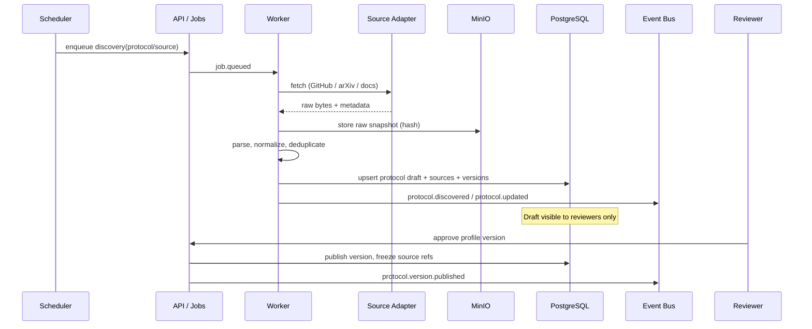
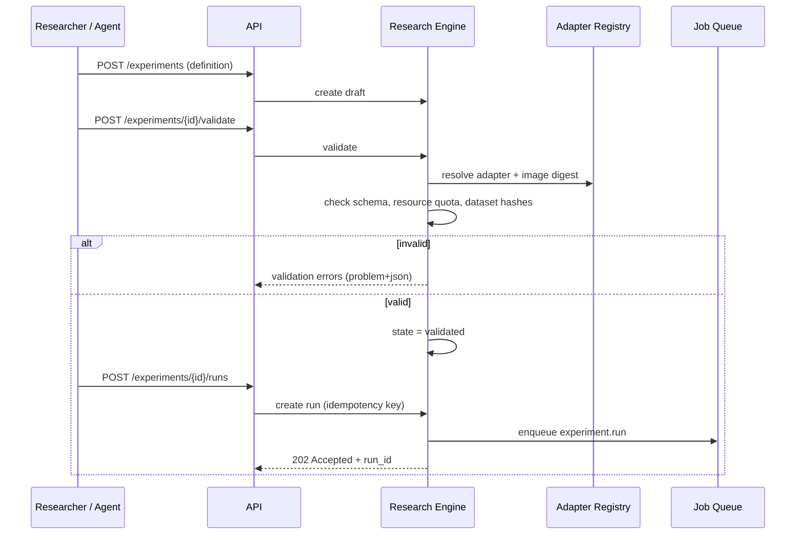
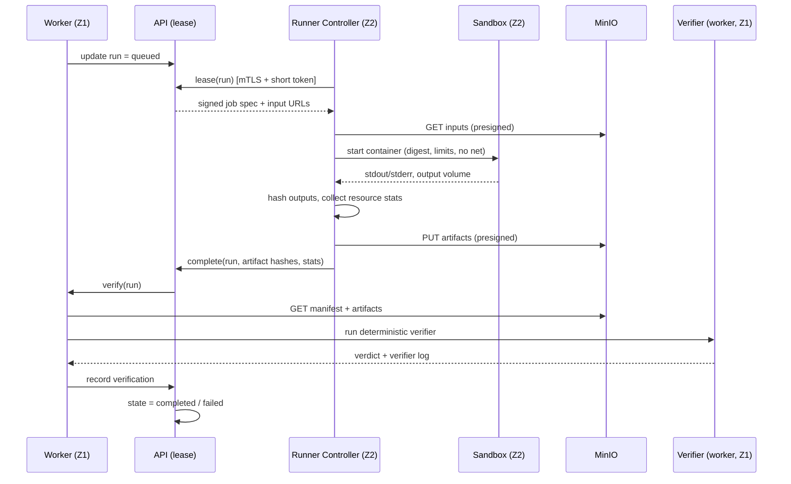
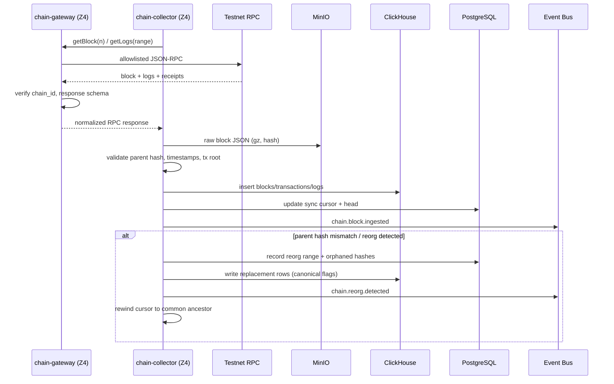
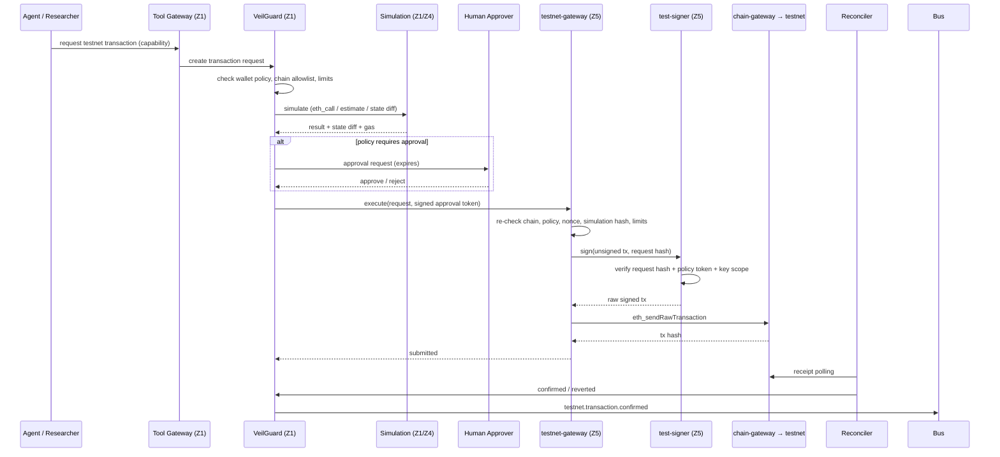
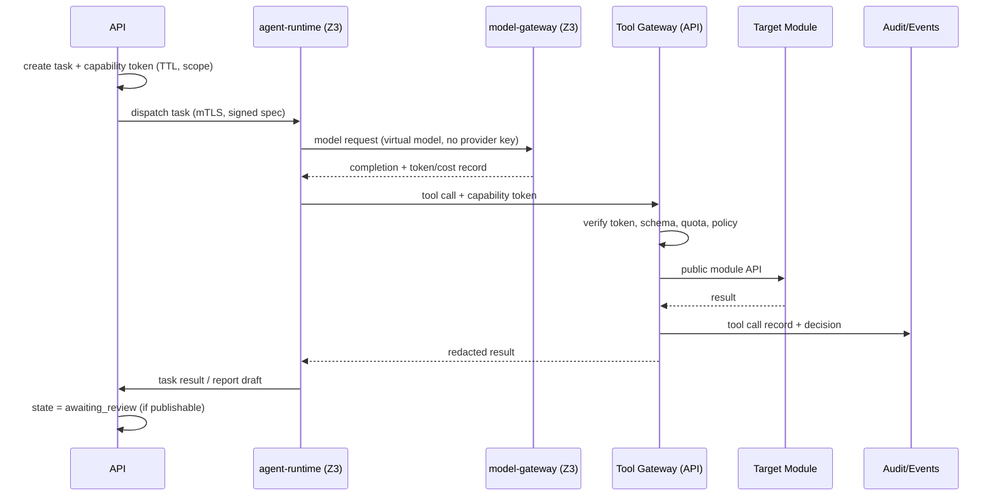

# Data Flow

**Status:** Draft · **Version:** 1.0 · **Date:** 2026-11-02
**Related:** [SYSTEM_ARCHITECTURE](SYSTEM_ARCHITECTURE.md) · [DATABASE_DESIGN](../database/DATABASE_DESIGN.md) · [NETWORK_ISOLATION](../security/NETWORK_ISOLATION.md)

---

## 1. Overview

VeilLab has six primary data flows:

1. Protocol discovery and registry curation.
2. Experiment definition, execution, verification and reproduction.
3. Cryptographic benchmark execution.
4. Testnet chain collection and reorganization handling.
5. Policy-gated testnet transaction execution.
6. Agent task execution and report generation.

Every flow obeys three rules:

- **Untrusted data stays data.** Fetched code, papers, RPC responses and model output are
  never executed as instructions or trusted as truth.
- **Artifacts are content-addressed.** Every input and output has a SHA-256 hash recorded
  in a manifest.
- **State transitions are owned by one module.** Other modules react to events.

---

## 2. Trust boundaries in the flows

| Boundary | Crossed by | Control |
| --- | --- | --- |
| Internet → Platform | GitHub, arXiv, docs, RPC, AI providers | Egress proxy, allowlist, parsing sandbox |
| API → Research runner | Job lease, inputs, outputs | mTLS, short-lived tokens, presigned URLs |
| Platform → Agent | Task spec, capability token, tool results | Capability scope, redaction, quotas |
| Agent → Testnet | Transaction request | Policy engine, simulation, human approval, signer |
| Testnet RPC → Chain data | Blocks, logs, receipts | Chain-ID pinning, parent-hash checks, reorg handling |
| Human → Published report | Review decision | Signed approval, audit, immutable version |

---

## 3. Protocol discovery

Controls:

- Fetching runs in `worker`, not in the API process, with timeout and size limits.
- HTML/PDF/code are parsed as untrusted data; no macros, no shell, no automatic build.
- Source snapshots are immutable objects in `raw/` bucket, referenced by hash.
- A protocol profile is never auto-published. Discovery creates a draft; a human approves.
- Repository build/execute is a separate experiment with sandbox controls, never part of
  discovery.

---

## 4. Experiment lifecycle

### 4.1 Definition and validation

Validation MUST check, at minimum:

- definition schema version and required fields;
- adapter exists and is compatible with the experiment type;
- container image is pinned by digest and present in the allowlisted registry;
- dataset versions exist and their content hashes match;
- requested CPU/memory/GPU/time limits are within project quota;
- network access request is `none` (default) or explicitly approved for a data-source
  experiment;
- no secret references are allowed in an experiment definition unless the adapter is
  first-party and the secret is injected by the runner, never exposed to the workload.

### 4.2 Execution

Key properties:

- The runner has **no database or Redis credentials**. It leases work through the API.
- The sandbox has **no network**, a read-only root filesystem, a non-root user, a
  per-run writable volume, and CPU/memory/PID/time limits.
- Inputs are mounted read-only; outputs are written to an isolated volume and uploaded by
  the runner controller after the sandbox exits.
- The runner's verdict is advisory. The worker re-hashes artifacts and runs a pinned,
  deterministic verifier. A malicious runner cannot mark an invalid proof valid without
  also forging the verifier output, which is checked against known-good code.
- If `artifact_hash != manifest.output_hash`, the run fails with `ARTIFACT_HASH_MISMATCH`.

### 4.3 Reproduction

A reproduction is a **new run** of the same experiment version with the same manifest
inputs, optionally on a different machine. It is not a re-labeling of the original run.
The result is linked via `reproduces_run_id`. Requirements are in
[REPRODUCIBILITY.md](../research/REPRODUCIBILITY.md).

---

## 5. Cryptographic benchmark flow

```mermaid
flowchart LR
    Def["Experiment vN<br/>workload + repetition plan"] --> Val["Validate toolchain digest"]
    Val --> Run["Runner: build + prove + verify"]
    Run --> Raw["Raw samples + logs + artifacts"]
    Raw --> Env["Environment fingerprint"]
    Env --> Stat["Statistics: median, p50, p95, stdev"]
    Stat --> Comp["Comparability check"]
    Comp --> Rec["benchmark_result + manifest"]
    Rec --> Pub["Report / Benchmark Center"]
```

- Compilation, proving and verification are measured as separate phases.
- Warm-up runs are recorded but excluded from the reported statistics using a declared rule.
- All raw samples are retained, not only the summary.
- Comparability requires matching environment fingerprint and workload; otherwise the
  result is labeled `non-comparable`.
- A benchmark that cannot produce a valid proof/verification is marked failed, not "fast".
- Details: [BENCHMARK_SPEC.md](../research/BENCHMARK_SPEC.md).

---

## 6. Chain collection and reorg handling

Rules:

- The collector never trusts the RPC's chain ID alone. The gateway pins the expected chain
  ID and, for local chains, the genesis hash. Public testnet identity is additionally
  cross-checked with a second provider for critical metadata where available.
- Blocks are stored raw before normalization. Raw data can rebuild derived tables.
- The canonical chain is determined by parent-hash linkage and, where available, the
  `finalized` block tag. Finality assumptions are per-network configuration.
- Reorgs are explicit events. Consumers MUST be able to handle orphaned rows and duplicate
  transaction hashes across blocks.
- Chain data is never used to authorize a transaction by itself; VeilGuard simulates and
  applies policy independently.

---

## 7. Testnet transaction flow

Hard requirements:

- The agent never has a key, signer endpoint or direct RPC route.
- The signer has **no network egress**. It only accepts a signing request from
  `testnet-gateway` over a local authenticated channel and returns a signed payload.
- The gateway re-validates everything the API decided. It does not trust the approval token
  blindly; it verifies signature, expiry, request hash, chain ID, wallet, nonce and limits.
- Simulation failure blocks execution unless a human explicitly overrides with a recorded
  reason (and even then, policy caps still apply).
- Daily wallet limits are enforced transactionally in PostgreSQL before signing.
- All requests, simulations, approvals, signatures and broadcasts are audited.

---

## 8. Agent task flow

Controls:

- Untrusted fetched content is wrapped with provenance and a trust label before it enters
  the model context. The agent is instructed to treat it as data, not instructions.
- Tool arguments are validated against JSON Schema; free-form shell, SQL and URL fetch are
  not tools.
- The tool gateway enforces per-task quotas (calls, tokens, artifacts, wall time).
- Results are redacted (secrets, absolute paths, internal hostnames) before returning to
  the agent.
- Any publish, deploy or execute action requires human approval, even if the capability
  allows the request.

---

## 9. Report generation and publication

1. Research worker collects evidence references: source commit, protocol version,
   experiment manifests, verifier outputs, benchmark records, security findings.
2. It builds a draft report with a machine-readable evidence graph. Every claim has an
   evidence ID or is labeled as interpretation.
3. A human reviewer checks claims against evidence, signs the review decision and records
   conflicts of interest.
4. Publication creates an immutable report version in MinIO (with manifest and signature),
   updates PostgreSQL metadata, and emits `report.published`.
5. Reports are never edited in place; corrections create a new version with a changelog.

---

## 10. Failure and recovery matrix

| Failure | Detection | State | Recovery |
| --- | --- | --- | --- |
| Source fetch timeout | adapter timeout | job retry | exponential backoff, max 5 |
| Malformed source | parser schema error | draft rejected | quarantine raw, manual review |
| Runner crash | lease heartbeat expiry | run `failed`/retry | requeue with attempt count |
| Artifact hash mismatch | verifier hash check | run `failed` | preserve artifacts, incident flag |
| Verifier failure | non-zero exit / schema | run `verifying_failed` | manual verifier review |
| RPC timeout | gateway timeout | cursor unchanged | retry with jitter |
| Reorg | parent hash mismatch | cursor rewind | re-collect orphaned range |
| Approval expired | token `exp` | request `expired` | new request + new approval |
| Signer unavailable | gateway error | request `signing_failed` | no retry without policy recheck |
| Broadcast rejected | RPC error | request `rejected` | reconcile nonce; never blind retry |
| Model provider failure | health check / 5xx | task retry/fallback | route to next allowed provider |
| Event duplicate | consumer idempotency key | none | ignore duplicate |
| Event poison | repeated consumer failure | DLQ | inspect, fix, replay |

---

## 11. Data classification in transit

| Data | Class | In transit | At rest |
| --- | --- | --- | --- |
| Source snapshots | Public/Internal | TLS via proxy | MinIO, hash-addressed |
| Protocol profiles | Internal | TLS | PostgreSQL |
| Experiment definitions | Internal | TLS | PostgreSQL |
| Raw artifacts | Internal/Confidential | presigned TLS | MinIO, object lock |
| Test wallet addresses | Internal | TLS | PostgreSQL |
| Test private keys | Restricted | never leaves signer | encrypted keystore |
| AI provider keys | Restricted | gateway only | secret store |
| Agent prompts | Internal | mTLS | redacted logs, 30-day max |
| Chain raw data | Public | TLS | MinIO/ClickHouse |
| Security findings (embargoed) | Confidential | TLS | PostgreSQL, restricted role |
| Audit log | Confidential | TLS | PostgreSQL append-only, offsite copy |
