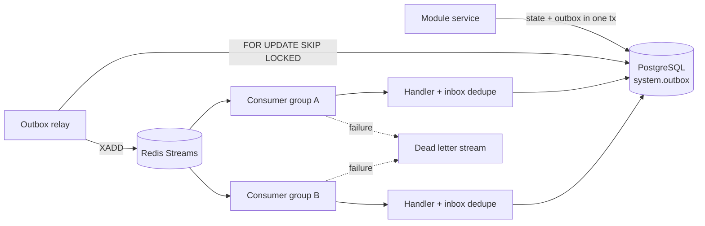

# Event Architecture

**Status:** Draft · **Version:** 1.0 · **Date:** 2026-11-02
**Related:** [EVENT_SCHEMA](../api/EVENT_SCHEMA.md) · [ADR-001](../adr/ADR-001-MODULAR-MONOLITH.md)

---

## 1. Goals

- Decouple business modules without introducing a broker-first distributed system.
- Guarantee that a committed state change eventually produces its event.
- Deliver at-least-once with idempotent consumers.
- Support replay for recovery, audits and new read models.
- Keep event contracts versioned and testable.
- Preserve traceability from API request to agent/task/experiment/testnet transaction.

---

## 2. Delivery model

**PostgreSQL transactional outbox + Redis Streams + Celery for work queues.**



Properties:

| Property | Guarantee |
| --- | --- |
| Atomicity | State change and event insert commit together |
| Delivery | At-least-once |
| Ordering | Per aggregate key, best effort; not global |
| Duplication | Possible; consumers MUST be idempotent |
| Replay | Supported from outbox archive / retained streams |
| Latency | p95 < 5 s (target) |
| Retention | Stream 7 days; outbox rows 7 days; archive 30 days |

Exactly-once delivery is **not** claimed. Exactly-once *effects* are achieved through
consumer-side idempotency.

---

## 3. Outbox table

```sql
CREATE TABLE system.outbox (
    id              text PRIMARY KEY,              -- evt_<ULID>
    type            text NOT NULL,                 -- dev.veillab.research.experiment.completed.v1
    source          text NOT NULL,
    subject         text NOT NULL,
    project_id      text,
    aggregate_type  text NOT NULL,
    aggregate_id    text NOT NULL,
    trace_id        text,
    correlation_id  text,
    causation_id    text,
    payload         jsonb NOT NULL,
    payload_schema  text NOT NULL,
    occurred_at     timestamptz NOT NULL,
    available_at    timestamptz NOT NULL DEFAULT now(),
    published_at    timestamptz,
    attempts        integer NOT NULL DEFAULT 0,
    last_error      text
);

CREATE INDEX ix_outbox_unpublished
    ON system.outbox (available_at)
    WHERE published_at IS NULL;

CREATE INDEX ix_outbox_aggregate
    ON system.outbox (aggregate_type, aggregate_id, occurred_at);
```

The relay:

1. Claims a batch with `SELECT ... FOR UPDATE SKIP LOCKED`.
2. Publishes to the stream for the event's domain (`vl.events.research`, etc.).
3. Marks `published_at` and trims the payload if policy allows.
4. On failure, increments `attempts`, sets `available_at` with exponential backoff.
5. After N attempts, moves to `system.outbox_dlq` and raises an alert.

The relay is a singleton with a PostgreSQL advisory lock or leader lease. Multiple relays
are safe because `SKIP LOCKED` prevents double-claiming, but ordering may change.

---

## 4. Streams and consumer groups

| Stream | Events | Consumer examples |
| --- | --- | --- |
| `vl.events.identity` | users, projects, capabilities | audit, web notifications |
| `vl.events.protocol` | discovery, versions | research, search index |
| `vl.events.research` | experiments, runs, datasets, reports | web, agents, reports |
| `vl.events.crypto` | builds, proofs, benchmarks | research, web |
| `vl.events.chain` | blocks, reorgs, sync health | veilguard, research, web |
| `vl.events.security` | assessments, findings | reports, web |
| `vl.events.veilguard` | simulations, approvals, transactions | audit, web, reconciler |
| `vl.events.agent` | tasks, tool calls, model usage | audit, web, cost |
| `vl.events.system` | jobs, plugins, policy denials | audit, ops |

Rules:

- One stream per bounded domain, not per event type.
- Consumer group name = service + purpose, e.g. `web-notifier`, `audit-writer`.
- Consumers maintain an inbox table `(consumer, event_id)` with a unique constraint.
- A consumer acknowledges only after its local transaction commits.
- Pending messages are reclaimed after a visibility timeout; handlers MUST be idempotent.
- Poison messages go to `vl.events.dlq` after 5 attempts with the failure reason.

---

## 5. Event envelope

CloudEvents 1.0-compatible envelope. Full schema and catalog in
[EVENT_SCHEMA.md](../api/EVENT_SCHEMA.md).

```json
{
  "specversion": "1.0",
  "id": "evt_01JB8Z4K2M9Q7R3T5V6W8X0Y1Z",
  "type": "dev.veillab.research.experiment.completed.v1",
  "source": "veillab.research",
  "subject": "projects/prj_01J.../experiments/exp_01J.../runs/run_01J...",
  "time": "2026-11-02T10:15:30Z",
  "datacontenttype": "application/json",
  "dataschema": "https://schemas.veillab.dev/events/experiment.completed/v1.json",
  "projectid": "prj_01J...",
  "traceid": "4bf92f3577b34da6a3ce929d0e0e4736",
  "correlationid": "job_01J...",
  "causationid": "evt_01J...",
  "data": {
    "experiment_id": "exp_01J...",
    "run_id": "run_01J...",
    "status": "completed",
    "verification_status": "verified",
    "manifest_hash": "sha256:..."
  }
}
```

Extension attributes are lowercase. The `data` object MUST NOT contain secrets, raw keys,
full prompts or unrestricted PII. Use references (`*_ref`, `*_id`) for large or sensitive
payloads.

---

## 6. Ordering

- Ordering is guaranteed only for events sharing the same `aggregate_type` + `aggregate_id`
  **and** published through the same stream partition.
- Redis Streams are ordered per stream. To preserve per-aggregate order, use a single
  stream per domain and do not publish the same aggregate concurrently.
- Consumers that require strict order MUST use an aggregate lock or a state-machine guard
  (e.g. reject `completed` before `started`).
- Cross-aggregate ordering is not guaranteed. Workflows use explicit state and
  reconciliation, not event arrival order.

---

## 7. Idempotency

Every consumer needs an inbox or an equivalent natural-key guard:

```sql
CREATE TABLE system.consumer_inbox (
    consumer    text NOT NULL,
    event_id    text NOT NULL,
    received_at timestamptz NOT NULL DEFAULT now(),
    PRIMARY KEY (consumer, event_id)
);
```

Handler pattern:

```python
async def handle(event: Event, tx: Session) -> None:
    if await inbox.seen(tx, consumer="report-generator", event_id=event.id):
        return
    await do_work(tx, event)
    await inbox.record(tx, consumer="report-generator", event_id=event.id)
    # commit atomically with work
```

For external side effects (email, webhook, chain broadcast), use an outbox on the consumer
side as well. Never perform a non-idempotent external call inside a retryable handler
without an idempotency key.

---

## 8. Schema evolution

- Event types end with a major version: `.v1`.
- **Additive** changes (new optional fields) are allowed within a major version.
- **Breaking** changes (remove/rename/retype a field, change semantics) require `.v2` and a
  dual-publish window of at least 30 days.
- Consumers MUST ignore unknown fields.
- Producers MUST NOT reuse a field name with different semantics.
- JSON Schema is stored in `packages/event_schema/` and validated in CI.
- The event catalog documents owner, payload, consumers and retention.

Compatibility check:

```bash
python scripts/check_event_schemas.py --baseline origin/main
```

---

## 9. Replay

Replay is a first-class operation, not a database hack.

1. Identify the consumer group and time range.
2. Pause the consumer group.
3. Reset the stream offset or replay from the outbox archive (`system.outbox_archive` /
   MinIO export).
4. Replay into a **staging consumer group** first; compare counts and hashes.
5. Switch the production consumer group.
6. Record the replay in the audit log with operator, reason and range.

Replay MUST be idempotent. If a consumer cannot handle replay, it is not ready for
production.

---

## 10. Security

| Concern | Control |
| --- | --- |
| Event spoofing | Internal streams only; Redis ACLs; producers authenticated by service identity |
| Unauthorized subscription | Per-service Redis ACL and stream names; no external subscribers |
| Data leakage | No secrets/PII in payloads; redaction at producer; schema review |
| WebSocket fan-out | Server filters by project membership and capability; never broadcasts raw internal events |
| Replay abuse | Operator-only, audited, rate-limited |
| Poison message | DLQ + size limit (256 KB default; large payloads by reference) |
| Tampering | Outbox is append-only for application roles; audit export is hash-chained |

---

## 11. Observability

Metrics:

- `outbox_pending`, `outbox_oldest_age_seconds`, `outbox_publish_failures`
- `stream_length`, `consumer_pending`, `consumer_oldest_age_seconds`
- `consumer_failures_total`, `dlq_size`
- `event_processing_duration_seconds` by type
- `replay_events_total`

Alerts:

| Alert | Condition |
| --- | --- |
| Outbox stuck | oldest unpublished > 60 s for 5 min |
| Consumer lag | pending > 10,000 or oldest > 10 min |
| DLQ non-empty | any message in DLQ |
| Schema violation | producer/consumer validation failure |
| Replay running | notify on start and completion |

Every event carries W3C `traceparent`; the relay and consumers propagate it. A trace should
show API request → job → experiment → verification → report.

---

## 12. Why not Kafka (yet)

Kafka adds operational complexity (brokers, partitions, retention, schema registry) that is
not justified at single-host research scale. PostgreSQL outbox + Redis Streams provides:

- transactional publication,
- replay,
- consumer groups,
- acceptable throughput (thousands of events/second),
- one fewer stateful system to back up.

Revisit when any of these is true for 30 days:

- sustained > 5,000 events/s,
- retention requirement > 30 days,
- multi-datacenter replication,
- more than ~20 independent consumer groups,
- stream data becomes a system of record.

The migration path is to keep the outbox contract and add a Kafka relay; consumers change
transport, not event semantics.
