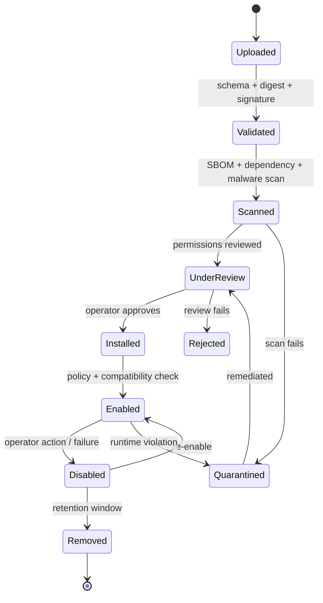

# Plugin Architecture

**Status:** Draft · **Version:** 1.0 · **Date:** 2026-11-02
**Related:** [MODULE_BOUNDARIES](MODULE_BOUNDARIES.md) · [THREAT_MODEL](../security/THREAT_MODEL.md)

---

## 1. Goals

VeilLab must add new chains, proof systems, security tools, data sources and model
providers without changing the core platform. The plugin system provides that extension
point **without trusting plugin authors by default**.

Non-goals:

- Plugins are not a way to run arbitrary code in the API process.
- Plugins do not receive database, Redis, wallet or model-provider credentials.
- Plugins cannot change platform policy, audit behavior or other plugins' permissions.
- The plugin system is not a public marketplace in v1.0; it is an operator-curated registry.

---

## 2. Plugin types

| Type | Runtime | Example | Default network | Default secrets |
| --- | --- | --- | --- | --- |
| `chain` | isolated worker | Ethereum, Base, Arbitrum adapter | restricted (RPC via chain-gateway) | none |
| `crypto` | isolated worker | Circom, Noir, OpenFHE, MP-SPDZ | none | none |
| `security` | isolated worker | Slither, Echidna, Semgrep | none | none |
| `data_source` | isolated worker | GitHub, arXiv, docs crawler | restricted via egress proxy | optional, scoped |
| `model_provider` | model gateway adapter | OpenAI-compatible endpoint | allowlisted provider only | provider key via broker |
| `benchmark` | isolated worker | custom benchmark harness | none | none |
| `ui` | sandboxed iframe (later) | custom visualization | none | none |

First-party adapters MAY run in-process only for **metadata or schema validation**. Any code
compilation, proving, verification, fuzzing, fetching or secret-adjacent work MUST run in an
`isolated_worker`, even for first-party plugins.

---

## 3. Bundle layout

```text
plugin/
├── manifest.yaml
├── plugin.py                # entrypoint (language-specific bundle allowed)
├── config.schema.json
├── permissions.yaml
├── dependencies.lock
├── sbom.json
├── tests/
├── README.md
└── SIGNATURE                # detached signature over the bundle digest
```

Bundles are stored in MinIO as content-addressed OCI artifacts or tarballs. Installation
records the digest, never a mutable tag.

---

## 4. Manifest

```yaml
plugin:
  id: veilab.crypto.circom
  name: Circom Adapter
  version: 1.4.0
  api_version: "1"
  type: crypto
  vendor: VeilLab
  license: Apache-2.0
  description: Circom compile/prove/verify adapter
  homepage: https://github.com/veillab/plugin-circom

runtime:
  type: isolated_worker
  image: registry.veillab.local/plugins/circom@sha256:...
  command: ["/plugin/run"]
  timeout_seconds: 1800
  cpu: 4
  memory_mb: 8192
  gpu: false
  filesystem: read_only
  network: none

permissions:
  - experiment.read
  - artifact.read
  - artifact.write
  - sandbox.execute

network:
  access: none
  allow: []

secrets:
  access: none
  refs: []

compatibility:
  platform: ">=0.1,<1.0"
  adapters: ["circom-2.x"]

limits:
  max_input_bytes: 104857600
  max_output_bytes: 1073741824
  max_wall_seconds: 1800
```

Validation rules:

- `id` is reverse-DNS and immutable.
- `version` follows semver; a published version cannot be reused with a different digest.
- `api_version` selects the host contract.
- Unknown runtime fields are rejected (fail closed).
- `network.allow` is ignored unless `access: restricted` and the host policy explicitly
  grants the destinations.
- `secrets.refs` are references, never values.

---

## 5. Host contract

Plugins communicate with the host through a narrow gRPC/HTTP contract. They do not import
platform Python packages and do not access platform databases.

```text
PluginService
├── Describe() -> PluginDescriptor
├── Health() -> HealthStatus
├── Validate(config) -> ValidationResult
└── Invoke(InvokeRequest) -> InvokeResult
```

`InvokeRequest` contains:

- `job_id`, `run_id`, `project_id`, `trace_id`
- `operation` (e.g. `compile`, `prove`, `verify`, `scan`, `fetch`)
- `config` validated against `config.schema.json`
- `inputs`: presigned read-only URLs or mounted input paths
- `outputs`: presigned write URLs or mounted output path
- `deadline`, `resource_limits`
- `capability_token` scoped to this invocation (not a platform session)

`InvokeResult` contains:

- status and structured error code
- artifact descriptors (path, media type, sha256, size)
- metrics (optional, schema-validated)
- logs (bounded, redacted)
- plugin version and toolchain versions

The host:

- verifies the bundle digest and signature before launch,
- creates an ephemeral sandbox with the declared limits,
- injects only the declared inputs,
- validates outputs and hashes,
- records the invocation and audit event,
- destroys the sandbox after completion.

---

## 6. Lifecycle



Rules:

- Installation is not enablement. An installed plugin has no runtime permission.
- Enabling requires an explicit permission grant per capability and per project scope.
- A plugin update is a new bundle. It does not inherit permissions silently; the operator
  re-approves changed permissions.
- Removing a plugin does not delete historical experiment artifacts; they remain
  reproducible via the pinned image digest and archived bundle.
- A quarantined plugin's jobs are cancelled and its tokens revoked.

---

## 7. Permissions

Plugin permissions are a separate namespace from agent capabilities. They are granted by a
human operator and bound to a plugin version + project.

| Permission | Meaning |
| --- | --- |
| `experiment.read` | Read experiment definitions needed for a job |
| `artifact.read` | Read declared input artifacts |
| `artifact.write` | Write declared outputs |
| `dataset.read` | Read declared datasets |
| `sandbox.execute` | Launch a nested tool inside the plugin sandbox |
| `network.restricted` | Reach explicitly allowlisted destinations |
| `secret.read:<ref>` | Receive a specific secret at runtime (rare; requires ADR) |
| `report.draft` | Submit a draft report section |
| `finding.draft` | Submit a draft security finding |

Denied by default:

- `database.*`, `redis.*`, `audit.write`, `policy.write`
- `wallet.*`, `signer.*`, `mainnet.*`
- `secret.read:*` for wallet or provider keys
- host filesystem, Docker socket, kernel capabilities

A plugin cannot grant permissions to itself or another plugin.

---

## 8. Isolation and sandboxing

| Control | Requirement |
| --- | --- |
| Container | Rootless, non-root UID, no privileged flag |
| Filesystem | Read-only root; per-run tmpfs/volume; no host mounts |
| Network | `none` by default; restricted via proxy if granted |
| Capabilities | Drop all Linux capabilities; no `CAP_SYS_ADMIN` |
| Seccomp | Default Docker/OCI profile or stricter |
| Resources | CPU, memory, PID, wall-clock, output size limits |
| Secrets | Injected only if explicitly granted; never in env or argv |
| GPU | Only for approved crypto plugins; exclusive allocation |
| Lifecycle | Ephemeral; destroyed after run; no reuse across projects |
| Logging | Bounded, redacted, no binary payloads |

High-risk plugins (untrusted build systems, fuzzing, network data sources) SHOULD use gVisor
or a microVM. The decision is recorded per plugin risk class.

---

## 9. Supply chain

1. Bundle is signed by the vendor/maintainer key.
2. Host verifies signature and digest against the registry record.
3. SBOM is generated and stored; dependencies are checked against a vulnerability database.
4. Images are scanned before install and on a schedule.
5. The plugin registry is append-only; a version cannot be replaced.
6. Builds are reproducible where feasible; toolchain digests are recorded.
7. Revocation list is checked at launch; a revoked version cannot start.

---

## 10. Versioning and compatibility

- Plugin API has a major version (`api_version`). Host supports N and N-1 during a
  transition window.
- Plugin semver: major = breaking contract/permissions, minor = new capability, patch = fix.
- A plugin declares compatible platform and adapter versions.
- The host refuses to enable a plugin with an incompatible API version.
- Historical runs pin the plugin digest; upgrading does not change past results.
- Deprecation requires 90 days notice for third-party plugins (v1.0+).

---

## 11. Failure handling

| Failure | Behavior |
| --- | --- |
| Manifest invalid | Reject install; no record enabled |
| Signature/digest mismatch | Reject; security event |
| Scan critical vulnerability | Quarantine; notify operator |
| Runtime crash | Job fails with plugin error; retry per policy |
| Timeout | Kill sandbox; `PLUGIN_TIMEOUT` |
| Output schema violation | Reject artifacts; `PLUGIN_OUTPUT_INVALID` |
| Output hash mismatch | Reject; `PLUGIN_ARTIFACT_MISMATCH` |
| Network policy violation | Kill sandbox; quarantine; SEV2 |
| Secret access violation | Kill; revoke; SEV1 |
| Repeated failures | Auto-disable after threshold; require review |

Plugin failures MUST NOT crash the host. Every invocation runs out-of-process with a
supervisor and a hard kill path.

---

## 12. Testing requirements

A plugin is not installable unless it provides:

- unit tests for its adapter logic,
- a contract test against the host API,
- a golden-output test with known hashes,
- a negative test for malformed input,
- a resource-limit test (timeout/memory),
- an SBOM and license report.

The platform CI additionally runs:

- sandbox escape probes,
- network denial probes,
- secret-access probes,
- output schema fuzzing,
- replay of a pinned example.

---

## 13. Operator workflow

```text
1. Upload bundle (CLI or UI)
2. Review manifest, permissions and diff versus previous version
3. Inspect scan results and SBOM
4. Approve install (recorded in audit)
5. Grant capabilities for a project
6. Enable and run a smoke test
7. Monitor first N invocations
```

A permission diff that adds network, secrets or `sandbox.execute` requires a second review
and a written justification.

---

## 14. Example: Circom adapter invocation

```json
{
  "job_id": "job_01J...",
  "run_id": "run_01J...",
  "operation": "prove",
  "config": {
    "circuit": "membership",
    "curve": "bn128",
    "protocol": "groth16"
  },
  "inputs": {
    "wasm": "s3://veillab-artifacts/.../circuit.wasm",
    "zkey": "s3://veillab-artifacts/.../circuit.zkey",
    "input": "s3://veillab-artifacts/.../input.json"
  },
  "outputs": {
    "proof": "s3://veillab-artifacts/.../proof.json",
    "public": "s3://veillab-artifacts/.../public.json"
  },
  "deadline": "2026-11-02T11:00:00Z",
  "resource_limits": {"cpu": 4, "memory_mb": 8192}
}
```

The adapter returns hashes and metrics. The research engine, not the plugin, decides whether
the run succeeded.
