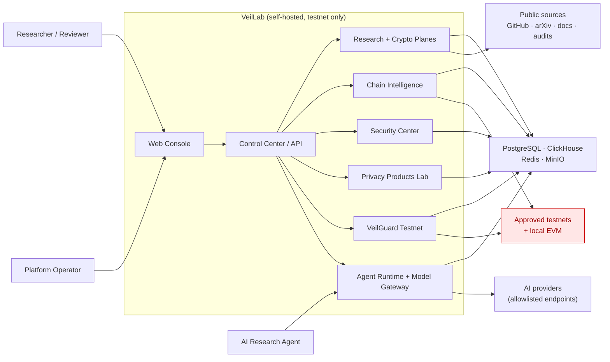
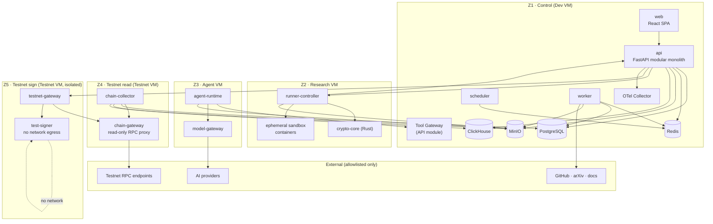

# System Architecture

**Status:** Draft · **Version:** 1.0 · **Date:** 2026-11-02
**Related:** [ADR-001](../adr/ADR-001-MODULAR-MONOLITH.md) · [ADR-002](../adr/ADR-002-TESTNET-ONLY.md) · [ADR-003](../adr/ADR-003-AGENT-ISOLATION.md)

---

## 1. Architectural drivers

| Driver | Consequence |
| --- | --- |
| Testnet only | No mainnet RPC, signer, broadcast path or production key material |
| Agent isolation | Agents run in a separate zone with capability tokens and no secrets |
| Reproducibility | Immutable manifests, pinned images, content-addressed artifacts |
| Security by design | Trust zones, least privilege, sandboxing, egress allowlists, audit |
| Single-operator first | Modular monolith, Docker Compose, one control plane |
| Extensibility | Versioned plugin contracts for chains, crypto, security and data sources |
| Research workloads are bursty | Queue-based scheduling; isolated runners; no API-process compute |
| Cryptographic diversity | Adapter layer; pinned toolchains; per-framework containers |

The architecture is intentionally **not** microservice-first. Business modules share one
process and one database transaction boundary; only workloads with different trust,
resource or failure characteristics become separate deployables.

---

## 2. System context



**Trust note:** arrows show logical data flow, not network permission. The Agent cannot
reach testnets, Chain Intelligence cannot reach AI providers, and VeilGuard cannot read
agent context. Exact rules are in [NETWORK_ISOLATION.md](../security/NETWORK_ISOLATION.md).

---

## 3. Container view



Not every arrow is a permanent connection: runners and agents use short-lived tokens and
presigned object URLs. `crypto-core` listens only on the Research zone loopback/private
network and accepts calls only from `runner-controller`.

---

## 4. Deployable units

| Unit | Zone | Language | Responsibility | Scale model |
| --- | --- | --- | --- | --- |
| `web` | Z1 | TypeScript / React | Console UI, no secrets, no RPC | Static, CDN/local nginx |
| `api` | Z1 | Python / FastAPI | Control plane, module composition, REST/WS | 1–2 replicas behind proxy |
| `scheduler` | Z1 | Python | Cron-like discovery, sync, maintenance triggers | Singleton with lease |
| `worker` | Z1 | Python / Celery | Orchestration, parsing, reports, non-crypto jobs | N workers, queue-based |
| `runner-controller` | Z2 | Python | Lease experiment jobs, launch sandbox, upload artifacts | 1 per Research VM |
| `crypto-core` | Z2 | Rust | Heavy primitives (Merkle, commitments, hashing, proof FFI) | gRPC, resource-limited |
| sandbox containers | Z2 | per adapter | Untrusted builds/proofs/fuzz workloads | Ephemeral, no network |
| `chain-collector` | Z4 | Python | Fetch, normalize, verify, reorg detection | 1 worker per network group |
| `chain-gateway` | Z4 | Python/Go | Single RPC egress point, method allowlist, chain-ID pinning | 1–2 replicas |
| `testnet-gateway` | Z5 | Python | Simulation, policy enforcement, approval check, broadcast | Singleton |
| `test-signer` | Z5 | Rust or Python | Isolated key use, transaction signing | Singleton, no egress |
| `agent-runtime` | Z3 | Python | Agent loop, tool calls, context budget | N task sandboxes |
| `model-gateway` | Z3 | Python | Provider abstraction, routing, metering, redaction | 1–2 replicas |
| `cli` | operator host | Python/Go | Local admin and research automation | N/A |

**Not deployable:** `cryptography/` Python packages, `core/` modules, `packages/contracts`.
They are libraries composed into `api`, `worker` or runner images.

---

## 5. Business planes

### 5.1 Research Plane

- Research studies, hypotheses, experiment definitions, runs, datasets, reports.
- Protocol Observatory and Registry (separate module, same plane).
- Benchmark Center and reproducibility verification.
- Owns `research` and `protocol` schemas.

### 5.2 Cryptography Plane

- Unified interfaces for proof systems, zkVM, FHE, MPC, commitments and Merkle trees.
- Adapter implementations and pinned toolchain images.
- Benchmark execution through the Research Engine, not a parallel scheduler.
- Owns `zk` schema; heavy computation runs in Z2.

### 5.3 Chain Intelligence Plane

- Testnet registry, collection, normalization, reorg handling, state verification.
- ClickHouse analytics and PostgreSQL chain metadata.
- Read-only chain gateway; no signing.
- Owns `chain` schema and ClickHouse `chain` database.

### 5.4 Security Plane

- Static analysis, fuzzing, symbolic execution, dependency scanning.
- Threat models, findings, evidence and reproduction environments.
- Owns `security` schema.

### 5.5 Product Plane

- Private identity, selective disclosure, confidential computing, verifiable privacy.
- Prototypes are experiments with product-specific schemas and contracts.
- Owns `privacy` schema.

### 5.6 VeilGuard Testnet Plane

- Test wallet registry, policies, simulation, approvals, transaction reconciliation.
- Owns `veilguard` schema.
- The only plane allowed to request a testnet signature, and only through the gateway.

---

## 6. Shared platform services

| Service | Responsibility | Implementation |
| --- | --- | --- |
| Identity | Users, sessions, PATs, OIDC, service identities | `core/control_center/identity` |
| Projects & Workspaces | Tenant boundary, membership, quotas | `core/control_center/projects` |
| IAM / Policy | RBAC, capability issuance, policy decisions | `core/control_center/iam` |
| Plugin Manager | Manifest validation, installation, permissions | `core/control_center/plugins` |
| Job Manager | Durable jobs, leases, retries, cancellation | `core/control_center/jobs` |
| Event Bus | Outbox, relay, subscriptions, replay | `core/control_center/events` |
| Dataset Manager | Versioned datasets and content hashes | `core/research/datasets` |
| Model Gateway | Provider registry, routing, metering, health | `apps/model-gateway` + `core/model_gateway` |
| Audit | Append-only actor/action/decision log | `core/control_center/audit` |
| Secret Broker | Reference-based access to secret store | `core/platform/secrets` |
| Observability | Metrics, logs, traces, audit export | OTel + Prometheus + Grafana |

---

## 7. Architectural rules

These rules are binding and testable.

1. **One business database transaction per module.** A module MUST NOT write another
   module's tables. Cross-module consistency uses the outbox/event pattern.
2. **Public interfaces only.** Cross-module imports go through `core/<module>/api.py`.
   ORM models and repositories are private.
3. **No direct external I/O from domain modules.** HTTP, RPC and AI calls go through
   adapters/gateways with policy, timeouts and audit.
4. **No secrets in agent context.** Agents receive capability tokens and virtual model
   IDs, never provider keys, wallet keys or database credentials.
5. **No mainnet code path.** There is no generic "send transaction to arbitrary chain"
   function. See [TESTNET_ONLY_POLICY.md](../security/TESTNET_ONLY_POLICY.md).
6. **Every long-running operation is a job.** API requests enqueue work and return `202`
   with a job/run identifier.
7. **Every experiment is reproducible by construction.** Inputs, environment and outputs
   are hashed; verification is a separate deterministic step.
8. **Every privileged action is audited.** Actor, capability, decision, resource and
   trace ID are recorded before the action takes effect where feasible.
9. **Fail closed.** Unknown chain, unknown plugin permission, unknown model provider,
   expired capability or missing policy ⇒ deny.
10. **Pinned supply chain.** Images, dependencies and toolchains are pinned by digest or
    lockfile; builds produce an SBOM.

---

## 8. Technology stack

| Layer | Choice | Notes |
| --- | --- | --- |
| Web | React + TypeScript + Vite | Strict TS, generated API client |
| UI | Tailwind CSS + shadcn/ui | Accessible primitives, research-console density |
| Charts | ECharts | Benchmark and chain analytics |
| API | Python 3.12+ / FastAPI | Async I/O, Pydantic v2, OpenAPI |
| ORM / migrations | SQLAlchemy 2.x + Alembic | Async sessions, forward-only migrations |
| Validation | Pydantic v2 | Shared request/response/event models |
| Core compute | Rust | `crypto-core`, signer primitives, parsers |
| Contracts | Solidity + Foundry | Testnet and local only |
| ZK | Circom, Noir, Halo2 | Adapter-isolated toolchains |
| zkVM | SP1, RISC Zero | Adapter-isolated toolchains |
| FHE | OpenFHE | CPU-heavy, dedicated queue |
| MPC | MP-SPDZ | Multi-process sandbox, no network |
| Metadata DB | PostgreSQL 16+ | Business truth, RLS, outbox |
| Analytics DB | ClickHouse 24.x LTS | Chain facts, columnar queries |
| Cache / queue | Redis 7+ | Celery broker, locks, rate limits |
| Object store | MinIO | Artifacts, datasets, raw chain, reports |
| Jobs | Celery | Queues per workload class |
| Containers | Docker + Compose | Four-zone topology; optional gVisor |
| Observability | Prometheus + Grafana + OpenTelemetry | Metrics, traces, structured logs |
| Secrets (v0.1) | SOPS + age / Docker secrets | No secrets in images or DB |
| Secrets (v1.0) | OpenBao (optional) | Dynamic credentials, audit |

Exact versions are frozen in lockfiles during P0. The stack table defines family and
integration contract, not floating versions.

---

## 9. Non-functional requirements

### Capacity (single-node baseline)

| Resource | Baseline |
| --- | --- |
| CPU | 16–32 physical cores |
| RAM | 64–128 GB |
| Storage | 2 TB NVMe (data) + 2 TB (backup) |
| GPU | Optional, exclusive to Research zone |
| Users | 10–50 concurrent |
| Jobs | 1,000/day sustained, 50 concurrent sandbox runs |
| Chain data | 6 testnets + 2 local networks, 12-month retention |

### Performance

| Metric | Target |
| --- | --- |
| Read API p95 | < 300 ms (excluding analytics queries) |
| Write API p95 | < 1 s (accepted, not completed) |
| Job dispatch latency p95 | < 10 s |
| Event delivery p95 | < 5 s |
| Chain ingestion lag p95 | < 30 s (testnets) |
| Web initial load (cold) | < 3 s on LAN |
| Benchmark harness overhead | < 2% of measured workload |

### Availability and recovery

| Metric | v0.1 | v1.0 |
| --- | --- | --- |
| Control-plane availability | 99% monthly (single node, best effort) | 99.5% |
| RPO — PostgreSQL | 24 h | 1 h (WAL archiving) |
| RPO — MinIO artifacts | 24 h | 1 h |
| RTO | 8 h | 4 h |
| Restore drill | Quarterly | Monthly |

### Security

- 100% of privileged actions audited.
- 0 agent capabilities that read key material or sign transactions.
- 0 registered mainnet RPC endpoints.
- All sandbox workloads: non-root, read-only root filesystem, no host mounts, no network,
  CPU/memory/PID/time limits.
- All images signed and accompanied by an SBOM before v1.0.
- All tenant tables protected by application scoping and, where enabled, PostgreSQL RLS.

### Observability

- Every job, experiment run, agent task and testnet transaction has a trace ID.
- Metrics: queue depth, job latency, runner utilization, proof time, chain lag, RPC errors,
  policy denials, token/cost usage.
- Logs are structured JSON, redacted at the emitter, retained per data lifecycle policy.

### Accessibility and UX

- WCAG 2.1 AA for the console.
- Every testnet view carries a persistent `TESTNET` badge.
- Destructive or signing actions require explicit confirmation and show the policy result.

---

## 10. Key flows

Detailed sequence diagrams live in [DATA_FLOW.md](DATA_FLOW.md).

1. **Protocol discovery:** scheduler → discovery job → source adapters → registry draft →
   human review → profile version.
2. **Experiment:** API → validation → queue → runner lease → sandbox execution → artifact
   upload → deterministic verifier → manifest → report.
3. **Agent task:** API issues capability → agent runtime → tool gateway → module action →
   audit/event → report draft → human review.
4. **Chain collection:** testnet RPC → chain-gateway → collector → normalize → reorg check
   → ClickHouse/Postgres/MinIO → event.
5. **Testnet transaction:** agent/API request → VeilGuard policy → simulation → approval →
   testnet-gateway → signer → chain-gateway broadcast → reconciliation → event.
6. **Benchmark:** experiment definition → controlled environment → repeated runs →
   statistical summary → comparability check → benchmark record.

---

## 11. Target repository layout

```text
VeilLab/
├── apps/
│   ├── web/                    # React console
│   ├── api/                    # FastAPI composition root
│   ├── worker/                 # Celery worker entrypoints
│   ├── scheduler/              # Scheduled jobs
│   ├── cli/                    # Operator CLI
│   ├── runner-controller/      # Research-zone job runner
│   ├── chain-collector/        # Testnet-zone collector
│   ├── chain-gateway/          # RPC egress proxy
│   ├── testnet-gateway/        # Testnet write path
│   ├── test-signer/            # Isolated signer
│   ├── agent-runtime/          # Agent loop
│   └── model-gateway/          # AI provider gateway
│
├── packages/
│   ├── contracts/              # Pydantic DTOs, event models, JSON Schema
│   ├── common/                 # IDs, time, errors, result types
│   ├── config/                 # Settings and validation
│   ├── event_schema/           # Generated event schemas
│   ├── sdk-python/
│   └── sdk-ts/
│
├── core/
│   ├── control_center/
│   ├── observatory/
│   ├── research_engine/
│   ├── cryptography/           # Python interfaces/engines
│   ├── chain_intelligence/
│   ├── security_center/
│   ├── privacy_products/
│   ├── veilguard/
│   ├── model_gateway/
│   ├── agents/
│   └── platform/
│
├── cryptography/
│   ├── core/                   # Rust workspace (crypto-core)
│   ├── interfaces/
│   ├── adapters/
│   ├── benchmarks/
│   └── toolchains/             # Pinned images and build recipes
│
├── adapters/
│   ├── chains/evm/
│   ├── crypto/
│   ├── ai/
│   └── data_sources/
│
├── products/
│   ├── private_identity/
│   ├── selective_disclosure/
│   ├── confidential_computing/
│   └── verifiable_privacy/
│
├── security/
│   ├── static_analysis/
│   ├── fuzzing/
│   ├── threat_models/
│   ├── dependency_scanner/
│   └── audit_reports/
│
├── agents/
│   ├── orchestrator/
│   ├── discovery/
│   ├── code_analysis/
│   ├── crypto_research/
│   ├── security_review/
│   ├── benchmark/
│   ├── report_generation/
│   └── runtime/
│
├── infrastructure/
│   ├── docker/
│   ├── postgres/
│   ├── clickhouse/
│   ├── redis/
│   ├── minio/
│   ├── sandbox/
│   ├── network_policy/
│   ├── observability/
│   └── secrets/
│
├── tests/
│   ├── unit/
│   ├── integration/
│   ├── security/
│   ├── performance/
│   ├── reproducibility/
│   └── network_isolation/
│
├── docs/
├── configs/
├── scripts/
├── docker-compose.yml
├── pyproject.toml
├── Cargo.toml
└── package.json
```

Logical boundaries are defined now; directories are created only when their phase starts.

---

## 12. Evolution triggers

The modular monolith is not a permanent constraint. Split a module into a service only when
at least one trigger is true:

| Trigger | Candidate split |
| --- | --- |
| Module needs a different trust zone or credential set | Already split: runner, collector, gateway, signer, agent |
| CPU/memory profile starves the API | Cryptography workers, chain indexing |
| Independent scaling is proven necessary by metrics | Chain collectors, model gateway |
| Team ownership requires independent deploys | Observatory, Security Center |
| Different availability/latency SLO | Chain query API |

Do **not** split merely for fashion. Distributed transactions, version skew and operational
overhead are real costs. Kafka is introduced only when event volume or retention exceeds
PostgreSQL outbox + Redis Streams capacity, not before.

---

## 13. Open questions (non-blocking)

| Question | Owner | Target |
| --- | --- | --- |
| OIDC provider choice (Authentik vs Keycloak vs external) | Platform | P1 |
| gVisor vs Firecracker for high-risk sandboxes | Security | P3 |
| OpenBao adoption timeline | Security | v0.5 |
| ClickHouse vs PostgreSQL for benchmark time series | Data | P4 |
| Model provider data-retention policy per provider | Security/AI | P5 |
| Multi-operator approval quorum | Security | v1.0 |
