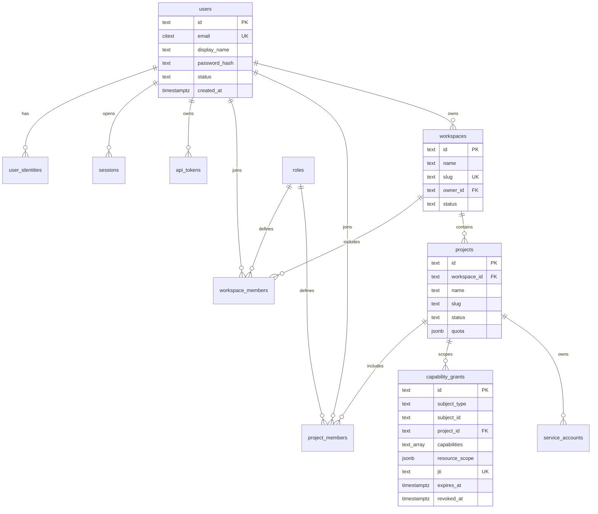
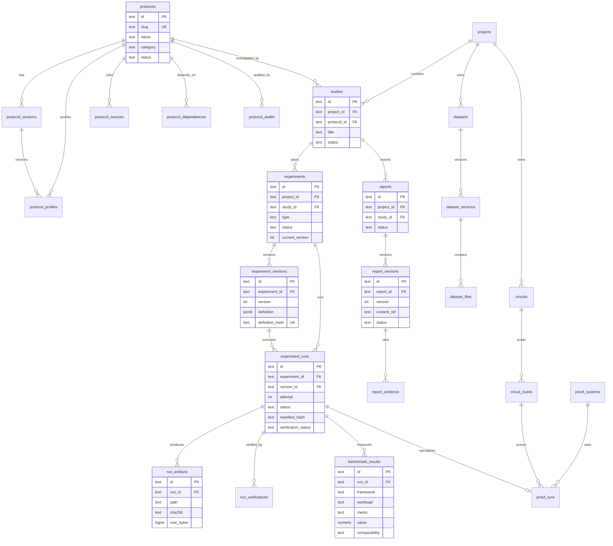
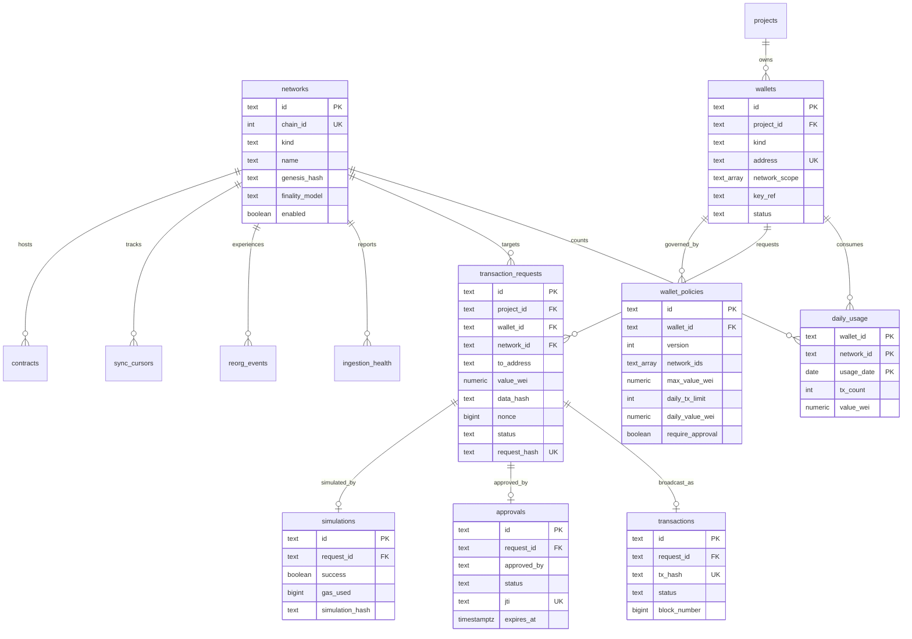
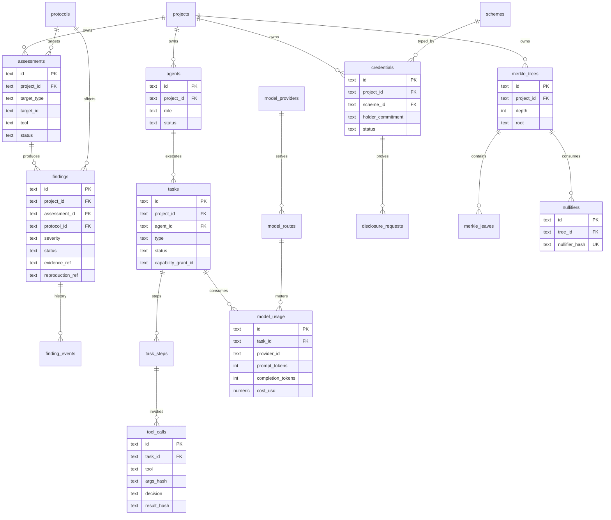

# Entity Relationship Diagrams

**Status:** Draft · **Version:** 1.0 · **Date:** 2026-11-02
**Related:** [DATABASE_DESIGN](DATABASE_DESIGN.md)

> Diagrams show principal relationships, not every column. Foreign keys may be logical
> (ID reference) across module boundaries to preserve ownership; those are marked in prose.

---

## 1. Identity and tenancy

Notes:

- `capability_grants.subject_id` references a user, service account, agent or task depending
  on `subject_type`. It is a logical reference, not a single-table FK.
- Workspace membership and project membership are separate. A project role never grants
  workspace administration.
- `api_tokens.project_id` optionally narrows a PAT to one project.

---

## 2. Protocol, research and cryptography

Notes:

- `experiment_versions` is immutable. Editing an experiment creates a new version.
- `experiment_runs.version_id` pins the exact definition used.
- `run_artifacts.path` is a content-addressed MinIO key; `sha256` is mandatory.
- `proof_runs.run_id` is unique when present; the experiment run is authoritative.
- `report_evidence.evidence_id` is a logical reference to a manifest, finding, protocol
  version or dataset; it is not a single FK.

---

## 3. Chain and VeilGuard

Notes:

- `wallets.key_ref` points to a key identifier inside the signer; it is not key material.
- One transaction request has at most one successful simulation and one approval; retries
  create new requests rather than mutating history.
- `daily_usage` is updated in the same transaction that reserves a signing slot.
- Chain facts (blocks/transactions/logs) are in ClickHouse, not in this diagram.

---

## 4. Security, agents and privacy products

Notes:

- `findings.protocol_id` links to the protocol registry; `assessment_id` links to the tool
  run that produced it.
- `tasks.capability_grant_id` is the durable grant; the runtime token is not stored.
- `tool_calls.args_hash` and `result_hash` allow audit without storing potentially sensitive
  payloads.
- Privacy tables store commitments and nullifiers, not raw attributes.

---

## 5. Logical references across module boundaries

| Reference | From | To | Rule |
| --- | --- | --- | --- |
| `project_id` | most tenant tables | `identity.projects` | FK allowed; RLS key |
| `protocol_id` | research/security | `protocol.protocols` | FK allowed; read-only for consumers |
| `run_id` | zk/research | `research.experiment_runs` | FK allowed |
| `job_id` | research/veilguard | `system.jobs` | logical; job may be pruned |
| `capability_grant_id` | agent.tasks | identity.capability_grants | FK allowed |
| `evidence_id` | research.report_evidence | manifest/finding/dataset | logical, typed |
| `key_ref` | veilguard.wallets | signer keystore | opaque reference, never a key |
| `wallet_id` | veilguard.* | veilguard.wallets | FK |
| `network_id` | chain/veilguard | chain.networks | FK |
| `plugin_id` | system.plugin_permissions | system.plugins | FK |

Logical references are validated by the owning module's public API and integrity jobs, not
by cross-schema joins in application queries.
