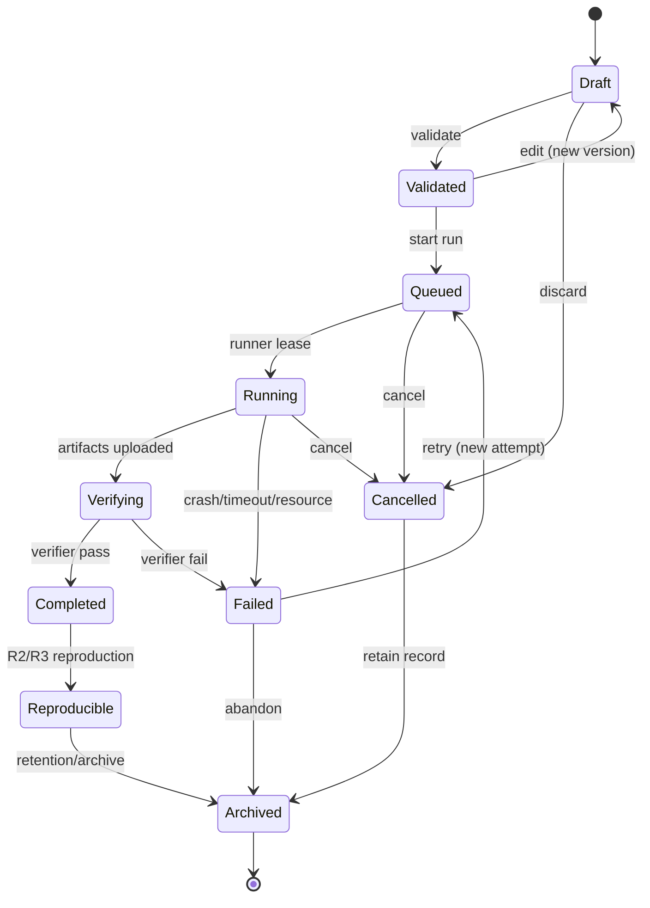

# Experiment Specification

**Status:** Draft · **Version:** 1.0 · **Date:** 2026-11-02
**Related:** [BENCHMARK_SPEC](BENCHMARK_SPEC.md) · [REPRODUCIBILITY](REPRODUCIBILITY.md) · [DATA_FLOW](../architecture/DATA_FLOW.md)

---

## 1. Purpose

An experiment is a **versioned, reproducible definition of a workload**. A run is one
execution attempt. The distinction matters:

- The definition is reviewed, validated and immutable once used.
- The run records what actually happened, including environment, artifacts and verification.
- A result without a manifest is not a result.

The platform, not an agent, decides whether a run succeeded.

---

## 2. Experiment vs run

| Concept | ID | Mutability | Owner |
| --- | --- | --- | --- |
| Experiment | `exp_...` | Metadata mutable; versions immutable | Research Engine |
| Experiment version | `ever_...` | Immutable | Research Engine |
| Run | `run_...` | State machine only | Research Engine |
| Job | `job_...` | State machine only | Job Manager |
| Manifest | `manifest_hash` | Immutable | Research Engine |

Starting a run pins the experiment version and its definition hash. Editing the experiment
after a run creates a new version; it never changes the existing run.

---

## 3. Definition schema

```yaml
api_version: veillab.dev/v1
kind: Experiment

metadata:
  name: semaphore-membership-bench
  project_id: prj_01J...
  study_id: study_01J...
  labels:
    protocol: semaphore
    category: membership

spec:
  type: benchmark            # benchmark | reproduction | protocol_analysis | security_assessment | chain_state | privacy_proof
  adapter: circom
  adapter_version: "1.4.0"

  source:
    repo: https://github.com/semaphore-protocol/semaphore
    commit: 0123456789abcdef0123456789abcdef01234567
    subdir: packages/circuits
    license: MIT

  environment:
    image: registry.veillab.local/zk/circom@sha256:...
    cpu: 4
    memory_mb: 8192
    gpu: none
    network: none
    timeout_seconds: 1800
    read_only_root: true

  inputs:
    datasets:
      - ds_01J...
    params:
      tree_depth: 20
      curve: bn128
      protocol: groth16
    seed: 42

  workload:
    operation: benchmark
    circuit: membership
    repetitions: 5
    warmup: 1

  verification:
    verifier: circom-groth16/v1
    checks:
      - proof_valid
      - public_inputs_match
      - constraints_match
      - artifact_hash
      - metrics_schema

  outputs:
    - metrics.json
    - proof.json
    - public.json
    - verify.log

  limits:
    max_output_bytes: 1073741824
    max_input_bytes: 104857600
    max_wall_seconds: 1800

  policy:
    allow_network: false
    allow_secrets: false
    allow_host_mounts: false
```

### Required fields

| Field | Rule |
| --- | --- |
| `api_version` | `veillab.dev/v1` |
| `kind` | `Experiment` |
| `metadata.name` | 3–80 chars, lowercase slug |
| `metadata.project_id` | Existing project |
| `spec.type` | One of the supported types |
| `spec.adapter` | Registered adapter, compatible with type |
| `spec.source` | Repo + 40-char commit, or dataset/source reference |
| `spec.environment.image` | Pinned by digest, allowlisted registry |
| `spec.environment.network` | `none` unless explicitly approved |
| `spec.verification.verifier` | Registered verifier + version |
| `spec.limits` | Within project quota |

### Rules

- All container images MUST be digest-pinned; tags are rejected.
- Source commits MUST be full 40-character hex; branches are rejected.
- Datasets MUST be sealed versions with a content hash.
- Secrets are forbidden in definitions. A first-party adapter that needs a credential
  receives it from the runner, never from the definition.
- Network access is denied by default; a data-source experiment needs an approved adapter
  and a destination allowlist.
- The definition MUST NOT embed raw PII or confidential datasets.

---

## 4. Lifecycle



| Transition | Actor | Guard |
| --- | --- | --- |
| `Draft → Validated` | Researcher/agent with `research:write` | Schema, quota, adapter, image, dataset, policy |
| `Validated → Queued` | Researcher/agent with `experiment.start` | Quota available, adapter enabled, image exists |
| `Queued → Running` | Runner (lease) | Valid signed job spec, lease acquired |
| `Running → Verifying` | Runner completes | Artifacts uploaded, hashes reported |
| `Verifying → Completed` | Deterministic verifier | All required checks pass |
| `Verifying → Failed` | Verifier | Any required check fails |
| `Running → Failed` | Supervisor | Timeout, crash, OOM, network attempt |
| any non-terminal → `Cancelled` | Authorized user/admin | Audit reason |
| `Failed → Queued` | Authorized user | New attempt, same version, retry budget |
| `Completed → Reproducible` | Research Engine | Independent run meets R2/R3 |

The state machine is enforced in the database with a transition guard and in the service
layer. An event cannot force an invalid transition.

---

## 5. Validation

Validation checks:

1. **Schema** — required fields, types, unknown fields rejected.
2. **Adapter** — registered, enabled, compatible version, image digest present.
3. **Source** — commit exists, repository allowlisted, license recorded.
4. **Datasets** — versions exist, hashes match, status `ready`.
5. **Resources** — CPU/memory/time within project and host quotas.
6. **Policy** — network disabled unless approved; no secrets; no host mounts.
7. **Verifier** — registered, compatible with adapter/type.
8. **Outputs** — declared paths are relative, no traversal, within size limits.
9. **Reproducibility** — environment fields sufficient for R1+.

Validation produces structured errors (field path, code, message) and never starts compute.

---

## 6. Runner contract

The runner controller leases work from the API. It has no database or Redis credentials.

### Lease request

```http
POST /internal/v1/runners/lease
Authorization: Bearer <short-lived runner token>
```

```json
{
  "runner_id": "runner_01J...",
  "capabilities": ["circom", "noir", "gpu:none"],
  "available_cpu": 8,
  "available_memory_mb": 32768
}
```

### Lease response

```json
{
  "job_id": "job_01J...",
  "run_id": "run_01J...",
  "experiment_id": "exp_01J...",
  "version": 2,
  "definition_hash": "sha256:...",
  "image": "registry.veillab.local/zk/circom@sha256:...",
  "command": ["/plugin/run", "--operation", "benchmark"],
  "inputs": [{"name": "dataset", "url": "https://minio/...", "sha256": "..."}],
  "outputs": [{"name": "metrics.json", "url": "https://minio/..."}],
  "limits": {"cpu": 4, "memory_mb": 8192, "wall_seconds": 1800, "output_bytes": 1073741824},
  "network": "none",
  "lease_expires_at": "2026-11-02T10:05:00Z",
  "trace_id": "4bf92f..."
}
```

The spec is signed by the API; the runner verifies the signature and `definition_hash`
before launching.

### Runner responsibilities

1. Verify the job signature and image digest.
2. Download inputs to a per-run volume and verify hashes.
3. Launch a rootless container with limits, no network, read-only root, non-root user.
4. Enforce wall-clock and output-size limits; kill on violation.
5. Capture stdout/stderr (bounded), resource metrics and exit code.
6. Hash every output; reject symlinks, path traversal and undeclared files.
7. Upload artifacts via presigned URLs.
8. Report completion with hashes and metrics; clean up the sandbox.
9. Never access the database, Redis, secrets, signer or internet.

### Heartbeat

Every 15 seconds; lease extended by 30 seconds. Two missed heartbeats allow the API to
reassign the run. A reassigned runner's results are rejected unless it still holds a valid
lease token.

---

## 7. Verifier contract

The verifier is trusted, pinned code running in the control zone, operating on untrusted
artifacts. It never executes experiment code.

### Input

- manifest
- artifact list with hashes
- experiment definition + version
- verifier name/version
- expected checks

### Output

```json
{
  "run_id": "run_01J...",
  "verifier": "circom-groth16",
  "verifier_version": "1.0.0",
  "status": "verified",
  "checks": [
    {"name": "artifact_hash", "status": "pass"},
    {"name": "proof_valid", "status": "pass"},
    {"name": "public_inputs_match", "status": "pass"},
    {"name": "constraints_match", "status": "pass"},
    {"name": "metrics_schema", "status": "pass"}
  ],
  "log_ref": "s3://veillab-artifacts/.../verify.log",
  "verified_at": "2026-11-02T10:20:00Z"
}
```

Rules:

- Every required check must pass for `verified`.
- A verifier error is `failed`, not `verified`.
- The verifier recomputes artifact hashes; it never trusts the runner's report.
- The verifier does not infer success from logs or exit code alone.
- Verifier code and version are recorded in the manifest.

---

## 8. Manifest

Every run produces an immutable manifest:

```json
{
  "manifest_version": "1",
  "experiment_id": "exp_01J...",
  "experiment_version": 2,
  "run_id": "run_01J...",
  "project_id": "prj_01J...",
  "study_id": "study_01J...",
  "type": "benchmark",
  "adapter": {"name": "circom", "version": "1.4.0"},
  "source": {
    "repo": "https://github.com/semaphore-protocol/semaphore",
    "commit": "0123456789abcdef0123456789abcdef01234567",
    "subdir": "packages/circuits",
    "license": "MIT"
  },
  "definition_hash": "sha256:...",
  "config_hash": "sha256:...",
  "inputs": [
    {"name": "dataset", "sha256": "sha256:...", "size_bytes": 1048576}
  ],
  "environment": {
    "image": "registry.veillab.local/zk/circom@sha256:...",
    "image_digest": "sha256:...",
    "network": "none",
    "cpu_limit": 4,
    "memory_mb": 8192,
    "gpu": "none",
    "timeout_seconds": 1800
  },
  "toolchain": {
    "circom": "2.1.9",
    "snarkjs": "0.7.4",
    "rust": null
  },
  "hardware": {
    "host_id": "research-vm-01",
    "cpu_model": "...",
    "physical_cores": 16,
    "memory_gb": 64,
    "gpu_model": null,
    "gpu_driver": null,
    "os": "Ubuntu 24.04",
    "kernel": "6.x"
  },
  "artifacts": [
    {"path": "metrics.json", "sha256": "sha256:...", "size_bytes": 2048},
    {"path": "proof.json", "sha256": "sha256:...", "size_bytes": 1280}
  ],
  "metrics": {
    "compile_ms": 8421,
    "prove_ms": 12030,
    "verify_ms": 41,
    "proof_size_bytes": 1280,
    "peak_rss_mb": 1820
  },
  "verification": {
    "verifier": "circom-groth16",
    "version": "1.0.0",
    "status": "verified",
    "checks_hash": "sha256:..."
  },
  "network_environment": "none",
  "runner": {"id": "runner_01J...", "version": "1.0.0"},
  "created_at": "2026-11-02T10:20:00Z",
  "manifest_hash": "sha256:..."
}
```

The manifest is stored in MinIO and referenced by hash. It is included in every
reproducibility bundle.

---

## 9. Artifact layout

Logical layout inside a run:

```text
runs/<run_id>/
├── manifest.json
├── SHA256SUMS
├── inputs/
├── artifacts/
│   ├── metrics.json
│   ├── proof.json
│   ├── public.json
│   └── verify.log
├── logs/
│   ├── runner.log
│   └── stderr.log
├── environment/
│   ├── fingerprint.json
│   └── image-digest.txt
└── verification/
    ├── verdict.json
    └── verifier.log
```

Physical object keys are content-addressed:

```text
veillab-artifacts/<project_id>/<run_id>/<sha256>/<filename>
```

The manifest maps logical paths to object keys and hashes.

---

## 10. Failure codes

| Code | Meaning | Retryable |
| --- | --- | --- |
| `VALIDATION_FAILED` | Definition invalid | No (fix definition) |
| `IMAGE_NOT_FOUND` | Digest missing | No |
| `INPUT_HASH_MISMATCH` | Input changed/corrupt | Yes (re-download) |
| `BUILD_FAILED` | Compile error | No (unless transient) |
| `PROOF_FAILED` | Prover error | No |
| `PROOF_INVALID` | Verifier rejects proof | No |
| `VERIFIER_ERROR` | Verifier crashed | Yes |
| `TIMEOUT` | Wall-clock exceeded | Yes (with higher limit) |
| `RESOURCE_EXCEEDED` | CPU/memory/output limit | Yes (with approval) |
| `NETWORK_DENIED` | Sandbox attempted network | No (security event) |
| `ARTIFACT_HASH_MISMATCH` | Output tampered/corrupt | No (security event) |
| `RUNNER_LOST` | Lease expired | Yes |
| `CANCELLED` | User/admin cancelled | No |

Retries create a new attempt, not a mutated run.

---

## 11. Quotas

| Resource | Default per project |
| --- | --- |
| Concurrent runs | 5 |
| CPU per run | 8 |
| Memory per run | 16 GB |
| GPU per run | 1 (if available) |
| Wall time | 30 minutes (max 4 hours with approval) |
| Output per run | 1 GB |
| Runs per day | 100 |

Quotas are reserved at queue time and released on terminal state.

---

## 12. Examples

### Protocol analysis

```yaml
api_version: veillab.dev/v1
kind: Experiment
metadata:
  name: semaphore-protocol-review
  project_id: prj_01J...
  study_id: study_01J...
spec:
  type: protocol_analysis
  adapter: source-analyzer
  adapter_version: "1.0.0"
  source:
    repo: https://github.com/semaphore-protocol/semaphore
    commit: 0123456789abcdef0123456789abcdef01234567
  environment:
    image: registry.veillab.local/analysis/source@sha256:...
    cpu: 2
    memory_mb: 4096
    network: none
  workload:
    operation: analyze
    analyzers: [semgrep, dependency_scan, permission_scan]
  verification:
    verifier: analysis-schema/v1
    checks: [findings_schema, evidence_refs, artifact_hash]
  outputs: [findings.json, dependencies.json, report.md]
```

### Privacy membership proof

```yaml
api_version: veillab.dev/v1
kind: Experiment
metadata:
  name: semaphore-membership-proof
  project_id: prj_01J...
  study_id: study_01J...
spec:
  type: privacy_proof
  adapter: circom
  adapter_version: "1.4.0"
  source:
    repo: https://github.com/semaphore-protocol/semaphore
    commit: 0123456789abcdef0123456789abcdef01234567
  environment:
    image: registry.veillab.local/zk/circom@sha256:...
    cpu: 4
    memory_mb: 8192
    network: none
  inputs:
    params:
      tree_depth: 20
      members: 1000
      nullifier_context: "veillab-test"
  workload:
    operation: prove
    circuit: membership
  verification:
    verifier: semaphore-membership/v1
    checks: [proof_valid, root_match, nullifier_derivation, artifact_hash]
  outputs: [proof.json, public.json, metrics.json]
```

---

## 13. Security constraints

- No network in the sandbox unless a data-source adapter is explicitly approved.
- No secrets in definitions, logs, artifacts or environment variables.
- No host mounts; only per-run input/output volumes.
- No privileged containers; drop capabilities; seccomp enabled.
- Source code is untrusted; build scripts run in the sandbox, never on the runner host.
- Archive extraction is bounded and path-checked (no zip-slip, no symlinks).
- Output size and file count are capped.
- A network attempt or artifact mismatch is a security event, not just a failed run.
- Verifier code is pinned and independent of the experiment adapter.

---

## 14. Definition of done

An experiment type is supported only when:

1. The adapter has a contract test and a golden output.
2. The verifier is deterministic and independently tested.
3. The manifest includes all fields required for R2.
4. A clean-machine reproduction succeeds.
5. Negative tests (bad hash, invalid proof, timeout, network attempt) pass.
6. The UI shows status, artifacts, verification and failure reason.
