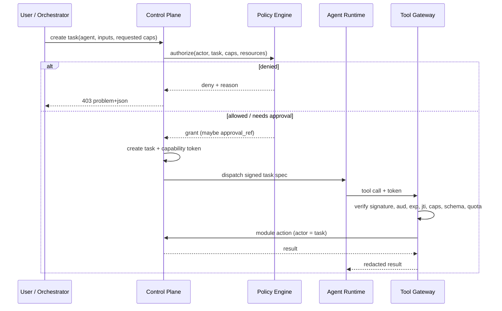

# Agent Permission Model

**Status:** Draft · **Version:** 1.0 · **Date:** 2026-11-02
**Related:** [ADR-003](../adr/ADR-003-AGENT-ISOLATION.md) · [THREAT_MODEL](THREAT_MODEL.md)

---

## 1. Core statement

> **An agent is a capability-scoped research worker. It is not an administrator, a wallet,
> a signer, or a source of truth.**

Agents can read research data, propose experiments, call analysis tools and draft reports.
They cannot read secrets, hold keys, sign transactions, change policy, publish without
review, or reach the internet outside the tool/model gateways.

---

## 2. Two separate authorization systems

| Subject | Model | Lifetime | Grantor |
| --- | --- | --- | --- |
| Human user | RBAC + project membership | Session / PAT | Workspace admin |
| Service | mTLS identity + scoped token | Minutes | Platform CA / control plane |
| Agent task | Capability token | ≤ 60 min (default 15) | Control plane, after policy check |
| Plugin invocation | Plugin permission + invocation token | Single job | Operator grant + host |

Agent capabilities are **never** derived from the human who created the task. A researcher
with wallet-admin rights does not automatically give an agent wallet rights. The task
definition must request capabilities explicitly, and policy must approve them.

---

## 3. Capability catalog

### Allowed by default for research agents

| Capability | Scope | Constraints |
| --- | --- | --- |
| `research.read` | Project | Read studies, experiments, reports |
| `protocol.discover` | Project | Create discovery drafts; no publish |
| `protocol.read` | Project | Read registry profiles and sources |
| `source.analyze` | Project | Parse repositories/documents in sandbox |
| `experiment.create` | Project | Create draft definitions only |
| `experiment.read` | Project | Read definitions, runs, manifests |
| `dataset.read` | Project | Read declared dataset versions |
| `sandbox.execute` | Project + task | Run approved adapter/tool in sandbox |
| `benchmark.propose` | Project | Propose benchmark plan; execution via queue |
| `report.draft` | Project | Create draft report sections |
| `finding.draft` | Project | Create draft findings |
| `model.invoke` | Task | Virtual model IDs within token budget |
| `artifact.read` | Task | Presigned URLs for task inputs |
| `artifact.write` | Task | Presigned URLs for task outputs |

### Restricted (require explicit grant and/or approval)

| Capability | Additional control |
| --- | --- |
| `testnet.simulate` | Wallet policy + chain allowlist; no signing |
| `testnet.deploy` | Human approval; contract allowlist; value = 0; gas cap |
| `testnet.execute` | Human approval; wallet policy; daily limits; simulation required |
| `security.scan` | Target must be a registered protocol/source; no external targets |
| `plugin.invoke:<id>` | Plugin must be installed, enabled and project-scoped |
| `report.publish` | Human reviewer approval; never autonomous |
| `experiment.start` | May be automatic for low-risk adapters; high-risk requires approval |

### Forbidden — no capability exists

| Action | Why |
| --- | --- |
| `wallet.private_key.read` | Keys never leave signer |
| `signer.sign` | Only testnet-gateway can request signatures |
| `mainnet.rpc.access` | No mainnet path exists |
| `mainnet.sign` | Does not exist |
| `policy.admin` | Agents cannot change policy |
| `audit.write` / `audit.delete` | Audit is append-only via trusted services |
| `secret.read` | No secret tool; broker not exposed |
| `database.query` | No database route or credential |
| `shell.exec` | No shell tool; approved adapters only |
| `http.fetch` | No arbitrary HTTP; data-source plugins are mediated |
| `plugin.install` | Operator-only |
| `user.manage` | Human admin only |

A request for a forbidden capability is rejected at token issuance and audited.

---

## 4. Capability token

Format: JWT (EdDSA/Ed25519), signed by the control plane. Short, explicit, audience-bound.

```json
{
  "iss": "veillab.control",
  "sub": "agent:benchmark/agt_01J...",
  "aud": ["veillab.api", "veillab.model-gateway"],
  "jti": "cap_01J...",
  "iat": 1762070400,
  "exp": 1762071300,
  "project_id": "prj_01J...",
  "task_id": "task_01J...",
  "caps": [
    "research.read",
    "experiment.read",
    "artifact.read",
    "artifact.write",
    "model.invoke"
  ],
  "limits": {
    "tool_calls": 200,
    "model_tokens": 250000,
    "wall_seconds": 3600,
    "artifact_bytes": 536870912
  },
  "resources": {
    "experiment_ids": ["exp_01J..."],
    "dataset_ids": ["ds_01J..."],
    "wallet_ids": []
  },
  "approval_ref": null
}
```

Validation rules:

- Signature verified against the control-plane public key (JWKS).
- `aud` must contain the receiving service.
- `exp - iat` ≤ 1 hour; default 15 minutes.
- `jti` checked against a revocation set (Redis) at each sensitive call.
- `project_id` must match the resource's project.
- `resources` are an allowlist; empty means no resource of that type.
- `limits` are enforced cumulatively per task.
- A token cannot be refreshed by the agent; renewal requires a new task/policy check.

Tokens are transmitted only in `Authorization: Bearer` over mTLS. They are never written to
logs, prompts, artifacts or model context.

---

## 5. Issuance flow



Capability escalation is impossible by design: the agent cannot mint tokens, change `caps`,
extend `exp`, or request a different audience.

---

## 6. Enforcement points

| Point | Enforcement |
| --- | --- |
| Task creation | Requested caps checked against agent role, project policy, resource scope |
| Token issuance | Signing, TTL, audience, quotas, revocation |
| Agent runtime | Network allowlist; no secrets; workspace-only filesystem |
| Tool gateway | Signature, audience, expiry, `jti`, capability, JSON Schema, quota, resource scope |
| Module API | Re-checks authorization with actor = task; never trusts gateway alone |
| Model gateway | Virtual model ID, token/cost budget, provider policy, redaction |
| Artifact access | Presigned URL bound to task and path; short TTL |
| Audit | Every allow/deny with actor, capability, resource, trace |

Defense in depth: if the tool gateway is bypassed, the module API still checks; if the
module API is compromised, the network still blocks secrets and RPC.

---

## 7. Tool catalog

| Tool | Capability | Input | Output | Approval |
| --- | --- | --- | --- | --- |
| `research.search` | `research.read` | query, filters | result list | — |
| `protocol.get` | `protocol.read` | protocol ID | profile | — |
| `protocol.propose` | `protocol.discover` | draft | draft ID | review to publish |
| `source.fetch` | `source.analyze` | registry source ID | parsed snapshot | — |
| `code.analyze` | `source.analyze` | snapshot ID, analyzers | findings draft | — |
| `experiment.create` | `experiment.create` | definition | draft ID | validation |
| `experiment.run` | `experiment.start` | experiment ID | run ID | policy-dependent |
| `experiment.status` | `experiment.read` | run ID | status + manifest | — |
| `dataset.read` | `dataset.read` | dataset ID | presigned URL | — |
| `artifact.put` | `artifact.write` | task path, bytes | hash | — |
| `benchmark.plan` | `benchmark.propose` | workload | plan draft | — |
| `security.scan` | `security.scan` | registered target | assessment ID | — |
| `finding.draft` | `finding.draft` | evidence | draft ID | review to publish |
| `report.draft` | `report.draft` | study ID, sections | draft ID | review to publish |
| `testnet.simulate` | `testnet.simulate` | wallet, tx | simulation | — |
| `testnet.request` | `testnet.deploy` / `testnet.execute` | wallet, tx | request ID | human |
| `model.complete` | `model.invoke` | virtual model, prompt | completion | — |

There is deliberately no `shell`, `sql`, `http`, `file.read` or `secret.get` tool.

---

## 8. Quotas and budgets

| Quota | Default | Enforced by |
| --- | --- | --- |
| Tool calls per task | 200 | Tool gateway |
| Model tokens per task | 250,000 | Model gateway |
| Model cost per task | $2 (configurable) | Model gateway |
| Wall time per task | 1 hour | Runtime supervisor |
| Artifact bytes per task | 512 MB | Artifact service |
| Concurrent tasks per project | 5 | Scheduler |
| Testnet requests per day | 10 per wallet | VeilGuard |
| Testnet value per day | Policy cap (test funds) | VeilGuard |
| Security scans per day | 20 | Scheduler |

Quotas are cumulative and reserved before the action. Exceeding a quota returns `429` with
a retry-after or requires a new task with a larger budget approved by a human.

---

## 9. Approval workflow

Human approval is required for:

- `testnet.deploy` and `testnet.execute`,
- `report.publish`,
- any security finding publication,
- capability escalation beyond defaults,
- plugin enablement,
- policy changes.

Approval record:

```text
request_id, task_id, project_id
action, resource, exact payload hash
simulation hash (for transactions)
risk summary and policy result
requested_by (agent/task), requested_at, expires_at
approved_by (human), approved_at, decision, reason
one-time nonce / jti
```

The approving human sees the exact action, not a natural-language summary generated by the
agent. For a transaction: chain, wallet, to, value, data (decoded where possible), gas,
simulation result and policy limits.

Approval expires (default 15 minutes for transactions, 24 hours for reports). Expired
approval cannot be reused.

---

## 10. Prompt injection defense

Untrusted content includes repositories, READMEs, papers, web pages, RPC metadata, model
output and plugin output.

Layered controls:

1. **Provenance wrapping.** Fetched content is inserted as structured data with source,
   hash and trust label, never concatenated into the system/developer instruction block.
2. **Instruction hierarchy.** The agent is told that content cannot grant permissions,
   change policy or authorize tools.
3. **Tool mediation.** Tool calls are checked by the gateway regardless of why the model
   produced them.
4. **Least capability.** A discovery task does not receive `testnet.*` or `report.publish`.
5. **Human approval.** Consequential actions require a human who sees the concrete payload.
6. **Output validation.** Tool arguments are schema-validated; free-form URLs, shell and
   SQL are not accepted.
7. **Egress control.** Even a successful injection cannot reach RPC, DB or secrets.
8. **Detection.** Log tool-call patterns; alert on capability denials and unusual sequences.
9. **Evaluation.** A prompt-injection suite runs in CI with known malicious fixtures.

Residual risk: an injection can cause wasted research effort, misleading drafts or noisy
tool calls. It cannot directly move funds or read keys.

---

## 11. Context and memory hygiene

- Task context contains only the minimum data needed: IDs, summaries, redacted excerpts.
- Secrets, tokens, internal hostnames and other tenants' data are removed by the redactor.
- Memory is task-scoped by default. Long-term memory is opt-in, labeled, expiring and
  reviewable.
- Untrusted content is never promoted to "trusted memory" automatically.
- Model provider retention is disabled where the provider supports it; otherwise only
  Internal-or-lower data may be sent.
- Raw prompts are not stored by default; hashes and metadata are stored for audit.

---

## 12. Logging and audit

For every task:

- task ID, agent ID, project, capability set, model(s), token/cost totals;
- each tool call: tool, argument hash, decision, duration, result hash;
- each denial: capability, resource, reason, policy ID;
- artifacts produced, with hashes;
- approval references and human decision.

Logs MUST NOT contain: capability token strings, provider keys, wallet keys, raw prompts by
default, or unredacted confidential data.

---

## 13. Revocation and kill switch

| Trigger | Action |
| --- | --- |
| Suspicious tool pattern | Revoke task token (`jti`), cancel task, notify operator |
| Prompt-injection detection | Pause agent, preserve context, require review |
| Secret-access attempt | Revoke all agent tokens, SEV1 incident |
| Policy change | New tokens use new policy; existing tokens expire ≤ 15 min |
| Global kill switch | Disable agent runtime, model gateway and testnet execution |
| Compromised agent image | Quarantine image, revoke tokens, rebuild |

The kill switch is a single operator action with an audit record. It must be tested in G6.

---

## 14. Test matrix

| Test | Expected |
| --- | --- |
| Agent requests `wallet.private_key.read` | Token issuance denied + audit |
| Agent calls tool without capability | 403 + audit |
| Agent uses expired token | 401 + audit |
| Agent uses token for another project | 404/403 + audit |
| Agent calls signer directly | Connection refused |
| Agent calls RPC directly | DNS/route failure |
| Agent calls tool with extra fields | 422 schema error |
| Agent exceeds tool quota | 429 |
| Agent attempts prompt injection from fixture | No privileged tool call; detection event |
| Human approves a different payload than requested | Gateway rejects hash mismatch |
| Replay approval token | Rejected by nonce/jti |
| Revoked token used | 401 |
| Kill switch active | All agent actions denied |

G5 requires all isolation tests to pass; G6 requires kill-switch and prompt-injection tests.
