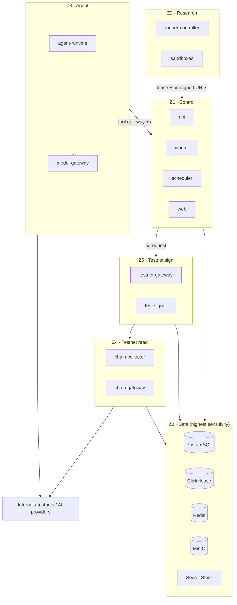

# Security Architecture

**Status:** Draft · **Version:** 1.0 · **Date:** 2026-11-02
**Related:** [THREAT_MODEL](THREAT_MODEL.md) · [NETWORK_ISOLATION](NETWORK_ISOLATION.md) · [TESTNET_ONLY_POLICY](TESTNET_ONLY_POLICY.md)

---

## 1. Security objectives

| Objective | Meaning |
| --- | --- |
| No mainnet capability | No mainnet RPC, signing, broadcast, keys or configuration path |
| No agent custody | Agents cannot read keys or authorize value transfer |
| Containment | Untrusted code, plugins and model output cannot reach secrets or control planes |
| Integrity | Experiments, reports and audit records are tamper-evident |
| Least privilege | Every human, service, agent and plugin has the minimum capability |
| Traceability | Privileged actions are attributable to an actor and a request |
| Recoverability | Backups and key rotation are tested, not assumed |

Security is enforced in depth: policy, application, data, network, runtime and CI. No single
layer is trusted to be sufficient.

---

## 2. Trust zones



Boundary rules:

- Z2, Z3 and Z5 cannot initiate connections to Z0 databases.
- Z3 cannot route to Z4 or Z5.
- Z2 cannot route to the internet at runtime.
- Z4 and Z5 are separate networks; only the gateway-to-gateway write path is allowed.
- Z5 signer has no default gateway and no DNS.

See [NETWORK_ISOLATION.md](NETWORK_ISOLATION.md) for the enforceable matrix.

---

## 3. Identity

### 3.1 Humans

- Local authentication for v0.1: Argon2id password hashes, optional TOTP.
- OIDC support for teams in v0.5 (provider decision deferred; see open questions).
- Session cookie: `HttpOnly`, `Secure`, `SameSite=Lax`, 12-hour idle / 7-day absolute.
- CSRF double-submit token for cookie-authenticated mutations.
- Personal access tokens (PATs): `vlp_` prefix, SHA-256 hashed at rest, scoped, expiring,
  last-used tracking, revocable.
- Failed login throttling with exponential backoff; no user enumeration.
- Password reset tokens are single-use and short-lived.

### 3.2 Services

- Every service has a distinct identity and credential set.
- Internal calls use mTLS with certificates issued by an internal CA.
- Service tokens are short-lived (≤ 15 minutes) and audience-bound.
- Database roles are per deployable, not shared (see [MODULE_BOUNDARIES](../architecture/MODULE_BOUNDARIES.md)).
- No service uses the API's user session to perform background work.

### 3.3 Agents and jobs

- Agents do not have platform identities with standing permissions.
- Each task receives a **capability token** bound to task, project, audience, expiry and
  resource limits. See [AGENT_PERMISSION_MODEL.md](AGENT_PERMISSION_MODEL.md).
- Tokens are EdDSA-signed by the control plane, short-lived (default 15 minutes, max 1 hour),
  and revocable by `jti`.
- A capability token is not a bearer wallet key and cannot be exchanged for one.

---

## 4. Authorization

Two complementary models:

### RBAC for humans

Roles: `workspace_owner`, `workspace_admin`, `project_admin`, `researcher`, `reviewer`,
`viewer`, `auditor`.

| Action | Owner | Admin | Researcher | Reviewer | Viewer | Auditor |
| --- | --- | --- | --- | --- | --- | --- |
| Manage workspace/billing | ✅ | ✅ | — | — | — | — |
| Manage project members | ✅ | ✅ | — | — | — | — |
| Create/edit experiments | ✅ | ✅ | ✅ | — | — | — |
| Run experiments | ✅ | ✅ | ✅ | — | — | — |
| Approve publication | ✅ | ✅ | — | ✅ | — | — |
| Approve testnet transaction | ✅ | ✅ | — | ✅ | — | — |
| Manage wallets/policies | ✅ | ✅ | — | — | — | — |
| Read audit log | ✅ | ✅ | — | — | — | ✅ |
| Change system policy | ✅ | — | — | — | — | — |

### Capabilities for agents, jobs and plugins

Capabilities are explicit strings such as `experiment.create`, `sandbox.execute`,
`testnet.simulate`. They are not inferred from roles. A capability grant has:

- subject (agent/task/plugin),
- project scope,
- resource constraints (dataset IDs, wallet ID, chain ID, token budget),
- time window,
- issuer and approval reference.

**Deny by default.** A missing capability, expired token, unknown audience or unknown
resource is a denial.

---

## 5. Secrets management

| Secret class | Storage | Access |
| --- | --- | --- |
| User passwords | Argon2id hash in PostgreSQL | API only |
| Session signing key | Secret file / secret store | API only |
| PATs | SHA-256 hash in PostgreSQL | API only |
| DB/Redis/MinIO credentials | Secret store or Docker secrets | Per-service role |
| AI provider keys | Secret store | Model gateway only |
| RPC credentials | Secret store | chain-gateway only |
| Test wallet keys | Encrypted keystore inside signer | test-signer only |
| Service mTLS keys | Per-service filesystem | That service only |
| Backup encryption keys | Offline/secret store | Restore operator only |

Rules:

1. Secrets MUST NOT be committed, baked into images, logged, traced or placed in event
   payloads.
2. Secrets MUST NOT enter an agent prompt, tool result or model context.
3. The API stores only `secret_ref` metadata, never secret values.
4. Secret values are injected at runtime through files or a broker, not command-line
   arguments (visible in process lists).
5. Every secret has an owner, rotation procedure and last-rotated date.
6. CI runs secret scanning (gitleaks or equivalent) on every commit.
7. Production-like deployments SHOULD use OpenBao (v0.5+) for dynamic credentials and audit.
8. v0.1 MAY use SOPS+age or Docker secrets; this is recorded as a accepted risk until
   OpenBao adoption.

### Rotation

| Secret | Interval | Procedure |
| --- | --- | --- |
| Session key | Quarterly / on suspicion | Dual-verify window, then revoke old |
| PAT | User-defined ≤ 90 days | Create new, revoke old |
| DB credentials | Quarterly | Create role password, rolling restart |
| AI provider key | Quarterly / on suspicion | Add new key, switch, revoke old |
| RPC key | Quarterly | Registry update, health check |
| Test wallet key | On compromise / annually | New wallet, migrate test funds, retire old |
| mTLS certs | 30–90 days | Short-lived certs, automated renewal |

---

## 6. Cryptography in the platform

| Purpose | Algorithm |
| --- | --- |
| Transport | TLS 1.2+ (prefer 1.3), strong cipher suites |
| At rest | AES-256-GCM or age (SOPS); disk encryption at host level |
| Password hashing | Argon2id (memory ≥ 64 MB, iterations tuned) |
| Token hashing | SHA-256 for high-entropy PATs; HMAC where lookup is needed |
| Capability tokens | Ed25519 / EdDSA |
| Artifact integrity | SHA-256 content hashes |
| Audit integrity | SHA-256 hash chain + daily signed anchor |
| Signing (testnet) | secp256k1 ECDSA, RFC 6979 where supported |
| Randomness | OS CSPRNG (`getrandom` / `secrets`), never `random` |

Rules:

- Do not invent cryptographic protocols. Use vetted libraries and test vectors.
- Key material is generated inside the component that uses it where possible.
- Cryptographic operations are constant-time where the library provides it; do not
  hand-roll comparisons.
- Experimental cryptography is confined to the Cryptography Plane and never protects
  platform credentials.
- ZK circuits and FHE parameters are research artifacts, not production security controls.

---

## 7. Network security

- Default deny ingress and egress per zone.
- Only explicitly registered testnet RPC endpoints are reachable from Z4.
- Only allowlisted AI provider endpoints are reachable from Z3 via the model gateway.
- No direct internet from Z2 at runtime; builds use a controlled mirror.
- DNS resolution for workloads is mediated by the egress proxy to prevent rebinding.
- RPC URLs are validated against the registry; user-supplied URLs are rejected.
- Internal services use mTLS; plaintext internal HTTP is allowed only on loopback.
- Admin interfaces (Grafana, MinIO console, Prometheus) are bound to admin networks and
  require authentication.

Details and firewall examples: [NETWORK_ISOLATION.md](NETWORK_ISOLATION.md).

---

## 8. Execution isolation

### Experiment sandbox

- Rootless container, non-root user, read-only root filesystem.
- No network namespace route (or `network: none`).
- CPU, memory, PID, wall-clock and output-size limits.
- No host mounts; per-run input/output volumes only.
- Dropped Linux capabilities; seccomp profile; no `privileged`.
- No Docker socket, no cloud metadata endpoint, no host IPC.
- Ephemeral: destroyed after the run, no reuse across projects.
- High-risk workloads use gVisor or a microVM (decision per adapter risk class).

### Agent runtime

- Separate VM/zone with no RPC and no database route.
- Only tools exposed by the tool gateway; no shell, no arbitrary HTTP, no filesystem
  outside its task workspace.
- Per-task CPU/memory/time/token quotas.
- Output is data, never executed by the platform.

### Signer

- Separate process with no network egress.
- Key material encrypted at rest, decrypted only in memory at startup or per request using
  a passphrase from the secret store.
- Accepts only a narrowly defined signing request from `testnet-gateway`, over a pinned
  local channel.
- Validates chain ID, request hash, nonce, recipient, value, data hash, gas and policy
  reference before signing.
- No key export API. No generic "sign bytes" endpoint.

---

## 9. Application security

| Threat | Control |
| --- | --- |
| SQL injection | SQLAlchemy parameterization; no string-built SQL; read-only analytics role |
| SSRF | Data-source adapters use an allowlist and egress proxy; block private/link-local IPs |
| XSS | React escaping; sanitize Markdown; strict CSP; no untrusted HTML |
| CSRF | SameSite cookies + double-submit token on mutations |
| IDOR | Every object access re-checks project membership and capability |
| Mass assignment | Explicit Pydantic DTOs; no ORM passthrough |
| File upload abuse | Size/type limits, archive bomb protection, malware scan, sandboxed preview |
| Deserialization | No pickle/YAML unsafe load on untrusted input; JSON only |
| Path traversal | Content-addressed storage keys; reject user-controlled paths |
| Replay | Idempotency keys, nonce checks, short-lived tokens |
| Rate limiting / DoS | Per-user/project/agent quotas; job queue isolation; body size limits |
| Error leakage | problem+json without stack traces or secrets; request ID for support |
| Dependency risk | Lockfiles, SBOM, vulnerability scanning, pinned images |
| Prompt injection | Provenance labels, tool mediation, no secrets, human approval |

Security headers (web):

```text
Content-Security-Policy: default-src 'self'; script-src 'self'; style-src 'self' 'unsafe-inline';
  img-src 'self' data:; connect-src 'self' wss://<host>; frame-ancestors 'none'; base-uri 'none'
Strict-Transport-Security: max-age=31536000; includeSubDomains
X-Content-Type-Options: nosniff
Referrer-Policy: no-referrer
Permissions-Policy: camera=(), microphone=(), geolocation=()
```

---

## 10. AI-specific security

AI agents are treated as **untrusted, capable users**, not as trusted operators.

| Risk | Mitigation |
| --- | --- |
| Prompt injection from fetched pages/papers/code | Content wrapped with provenance and trust label; instructions say data is not instructions |
| Tool abuse | Capability tokens, per-tool schemas, quotas, policy checks, audit |
| Secret exfiltration | No secrets in context; model gateway redaction; egress allowlist |
| Data exfiltration via prompts | Provider allowlist; confidential data not sent to external models by default |
| Malicious model output | Treated as data; validated before storage; never executed |
| Supply-chain model/provider | Provider registry, health checks, key isolation, no dynamic base URLs from agents |
| Cost/DoS | Token and cost budgets per task/project; rate limits |
| Autonomous harmful action | Publish/deploy/execute always require human approval |
| Memory poisoning | Memory entries are scoped, labeled and expire; no automatic trust promotion |

Model gateway rules:

- Agents receive a **virtual model ID**, not a provider key or arbitrary base URL.
- Provider base URLs are registry-controlled and allowlisted.
- Requests and responses are logged with redaction; raw prompts are off by default.
- Tool calls are mediated by the API, not executed by the model provider.
- A provider failure degrades to an approved fallback; it does not bypass policy.

---

## 11. Testnet security

- No real funds. Test wallets are clearly labeled and hold only faucet assets.
- Wallet keys are isolated in the signer and never enter the API, agent or worker.
- Every transaction is simulated and policy-checked.
- Value, gas, contract, selector, chain and daily limits are enforced.
- High-risk actions require human approval with an expiring token.
- A kill switch disables all signing and broadcasting immediately.
- Reconciliation detects stuck, replaced or reverted transactions.
- Mainnet chain IDs are explicitly denied and tested; unknown networks are denied.
- The UI displays a persistent testnet badge and the chain ID on every confirmation.

See [TESTNET_ONLY_POLICY.md](TESTNET_ONLY_POLICY.md) and
[AGENT_PERMISSION_MODEL.md](AGENT_PERMISSION_MODEL.md).

---

## 12. Supply chain

- Python: `uv` lockfile; Node: `pnpm` lockfile; Rust: `Cargo.lock`.
- Base images pinned by digest; no `latest`.
- Images built in CI, signed (cosign), SBOM generated (Syft/CycloneDX).
- Dependency vulnerability scanning (Trivy/Grype) blocks critical findings.
- SAST (Semgrep) and secret scanning on every PR.
- Third-party plugins are signed, scanned and permission-reviewed before enablement.
- Builds use a controlled package mirror; runtime containers do not install packages.
- Reproducible builds are a v1.0 goal for crypto toolchain images.

---

## 13. Audit and monitoring

### Audit log

Every privileged action records:

- event ID, timestamp (UTC),
- actor type and ID (user/service/agent/plugin),
- capability or role used,
- action and resource,
- project ID,
- decision (`allow`/`deny`) and reason,
- request/trace ID,
- before/after hash or summary (not secrets),
- source IP / service identity.

Audit is append-only. Application roles have `INSERT` and `SELECT`, no `UPDATE`/`DELETE`.
A daily job computes a hash chain and writes a signed anchor to MinIO (object lock).

### Monitored signals

- Mainnet chain ID or RPC hostname detection.
- Signer access from unexpected client or any egress attempt.
- Capability denial spikes, especially `testnet.*` and `secret.*`.
- Agent tool calls with unusual frequency or argument patterns.
- Sandbox network attempts, privilege escalation, host mount attempts.
- Secret scanning findings, dependency criticals.
- Failed logins, PAT misuse, cross-tenant access attempts.
- Backup failures and restore test failures.

Alerts route to the operator; SEV1 alerts also trigger the incident process.

---

## 14. Data protection

Classification: `Public`, `Internal`, `Confidential`, `Restricted`.

| Class | Examples | Controls |
| --- | --- | --- |
| Public | Published reports, public protocol data | Integrity, publication review |
| Internal | Experiment definitions, chain data, agent tasks | Auth, project scoping |
| Confidential | Embargoed findings, unpublished reports | Need-to-know, encryption, audit |
| Restricted | Keys, secrets, credentials, raw PII | Isolation, encryption, no logging |

- Tenant isolation is enforced in the application and, where enabled, PostgreSQL RLS.
- Sensitive fields are encrypted at rest where they are not hashes (e.g. contact info).
- Logs redact secrets, tokens, keys, full prompts and PII.
- Data leaving the platform to AI providers is minimized and policy-controlled.
- Backups are encrypted and restore-tested.
- Retention and deletion follow [DATA_LIFECYCLE.md](../database/DATA_LIFECYCLE.md).

---

## 15. Secure SDLC

| Stage | Requirement |
| --- | --- |
| Design | Threat model update for new trust boundary, capability or external destination |
| Code | Type checks, lint, unit tests, no secrets, dependency review |
| PR | Security checklist, CODEOWNERS for security-sensitive paths |
| CI | SAST, secret scan, dependency scan, container scan, architecture tests |
| Pre-release | Gates G0–G8, restore drill, reproducibility check |
| Deploy | Signed images, migrations reviewed, rollback plan |
| Operate | Patch cadence, alert review, access review, incident drills |
| Retire | Data deletion, credential revocation, key destruction |

Security-sensitive paths (auth, IAM, signer, gateway, network policy, migrations, agent
tools) require review by the security owner.

---

## 16. Control matrix

| Control | Requirement | Verification |
| --- | --- | --- |
| Mainnet denial | No mainnet chain in registry; unknown denied | G1 test suite |
| Agent key isolation | No capability or route to keys/signer | G5 test suite |
| Sandbox isolation | No network, non-root, limits | G6 test suite |
| Tenant isolation | Project scoping + RLS | Cross-tenant tests |
| Secret handling | No secrets in logs/context/DB plaintext | Secret scan + log redaction tests |
| Audit integrity | Append-only + hash chain | Daily anchor verification |
| Backup recovery | Restore within RTO | G8 drill |
| Dependency safety | No critical vulnerabilities | CI scan |
| Plugin isolation | Sandbox + permissions | Plugin security tests |
| Prompt injection resistance | Tool policy + approval | Adversarial eval suite |
| Chain identity | Chain ID + genesis pinning | Gateway tests |
| Signer isolation | No egress; pinned client | G5/G6 network tests |

---

## 17. Residual risks (accepted for v0.1)

| Risk | Why accepted | Review trigger |
| --- | --- | --- |
| Single-host dev setup has logical, not physical, isolation | Cost/complexity | Before any multi-user deployment |
| SOPS files instead of dynamic secret broker | Simplicity | v0.5 OpenBao adoption |
| No HSM for test keys | Test-only funds | v1.0 or any real-value use (not allowed) |
| External AI providers may log prompts | Contractual/provider policy | Before confidential data use |
| Docker isolation is weaker than microVM | Performance/complexity | High-risk plugin or untrusted build |
| Single operator has broad access | Scale | Team deployment |

Accepted risks are reviewed at each release gate and must have an owner and expiry.
