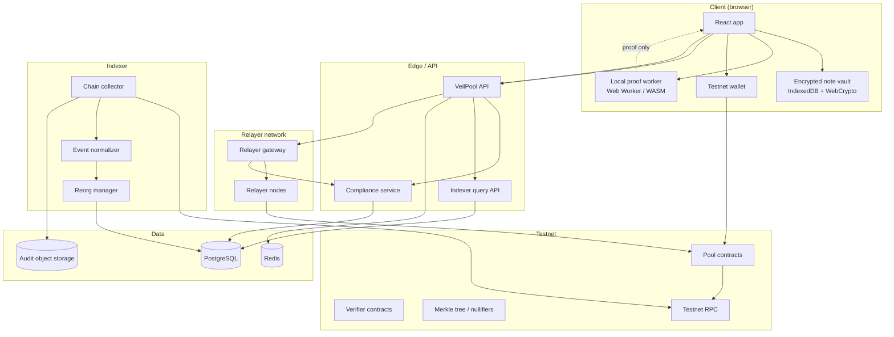
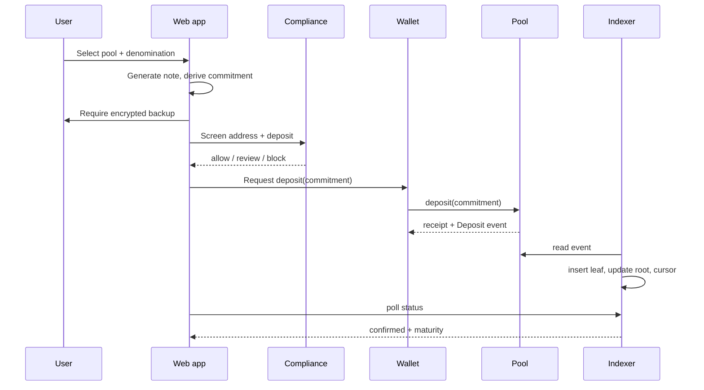
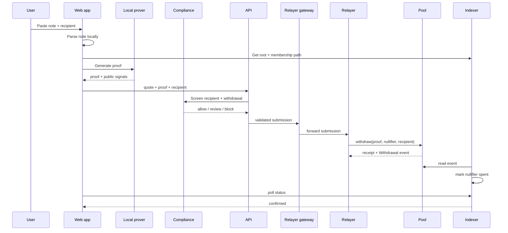

# VeilPool Architecture

**Status:** Current · **Version:** 1.0 · **Date:** 2026-11-02
**Related:** [Pool Model](POOL_MODEL.md) · [Data Model](DATA_MODEL.md) · [Testnet Policy](../security/TESTNET_ONLY_POLICY.md)

---

## 1. Design goals

- Keep notes on the client; never send them to a server.
- Keep relayers non-custodial.
- Make compliance and limits explicit.
- Survive indexer lag, RPC failure and reorgs.
- Make every withdrawal idempotent and auditable.
- Make mainnet access structurally impossible.

Non-goals: production-grade anonymity guarantees, mainnet, cross-chain mixing, arbitrary
amounts, custodial accounts.

---

## 2. Container view



**Critical rule:** the path from the client to the relayer carries only a proof, public
signals, recipient and fee quote. It never carries the note.

---

## 3. Components

| Component | Responsibility | Trust level |
| --- | --- | --- |
| Web app | Screens, note vault, wallet, proof orchestration | Untrusted client |
| Local proof worker | Generate membership proof from note + tree path | Local, no network |
| API | Pools, quotes, submission status, compliance calls, indexer queries | Trusted service |
| Compliance service | Sanctions, jurisdiction, limits, review | Trusted, audited |
| Relayer gateway | Validate relayer request, route to relayer nodes | Trusted edge |
| Relayer node | Submit withdrawal transaction | Semi-trusted, non-custodial |
| Indexer | Chain events → leaves, nullifiers, cursors, reorgs | Trusted data plane |
| Pool contract | Deposits, withdrawals, nullifier checks | On-chain truth |
| Verifier contract | Verify proof | On-chain truth |
| PostgreSQL | Pool metadata, indexed events, compliance, audit | System of record |
| Redis | Queue, locks, rate limits, idempotency | Ephemeral |
| Audit storage | Immutable compliance and submission evidence | WORM/object lock |

---

## 4. Trust zones

| Zone | Contains | Rules |
| --- | --- | --- |
| Z0 Client | Note vault, prover, wallet | Notes never leave; no server-side proving |
| Z1 Edge/API | API, compliance, indexer query | mTLS internally; no note endpoints |
| Z2 Relayer | Gateway, relayer nodes | No note access; policy checked |
| Z3 Chain | Contracts, RPC | Testnet only; no mainnet path |
| Z4 Data | PostgreSQL, Redis, audit storage | Least privilege; encrypted; no notes |
| Z5 Admin | Operator console, review queue | Human approval, audit |

The relayer zone cannot read the client vault or the API’s private tables. The API cannot sign
withdrawals. Only the user’s wallet (deposit) or a relayer (withdrawal) submits transactions.

---

## 5. Deposit flow



Failure behavior:

- Compliance block → no wallet prompt.
- User rejects wallet → note remains `backed_up`, deposit `cancelled`.
- Revert → note remains unspent; no leaf.
- Indexer lag → UI shows `submitted`, not `confirmed`.
- Reorg → deposit may return to `pending`; replay resolves.

---

## 6. Withdrawal flow



Failure behavior:

- Note invalid → stop before proof.
- Stale root → refresh; do not prove against an unobserved root.
- Proof invalid → no submission; show verifier error.
- Compliance block → no relayer submission.
- Relayer timeout → fallback relayer; proof remains local.
- Transaction revert → note remains unspent; show reason.
- Nullifier already spent → mark note spent; no retry.

The public entry point is the API (`/withdrawals/quote`, `/withdrawals/submit`). The API
forwards a validated request to the relayer gateway. The client does not need a direct
connection to individual relayer nodes.

---

## 7. Indexer and reorg handling

```text
RPC → collector → raw event log → normalizer → PostgreSQL
                                      ├── deposits
                                      ├── withdrawals
                                      ├── nullifiers
                                      ├── roots
                                      └── cursors
```

Rules:

- Read logs by block range with a bounded batch.
- Store `(tx_hash, log_index)` unique.
- Verify `chain_id` on every RPC connection.
- Track `block_hash`, `parent_hash`, `confirmations`, `finality`.
- On reorg: find common ancestor, roll back affected leaves/nullifiers, replay canonical
  blocks, recompute roots, emit a `reorg` audit event.
- Rebuild test: replay all events from genesis → same root and nullifier set.
- A stale root blocks withdrawal until the indexer catches up.

**MVP implementation (`apps/indexer/`):** the service polls Anvil JSON-RPC, verifies chain ID
31337, normalizes `Deposit` / `Withdrawal` / `RootUpdated` / `PoolPaused` / `PoolResumed` /
`PoolCreated` into SQLite, rolls back to a common ancestor on reorg, replays canonical blocks,
and serves `GET /health`, `/pools`, `/pools/{id}/deposits`, `/pools/{id}/roots`,
`/pools/{id}/path/{commitment}` and `/withdrawals/{nullifier}`. The path endpoint rebuilds the
depth-20 Poseidon tree from canonical deposits and returns public path elements only. The API
consumes it in `VEILPOOL_MODE=local`; mock mode keeps the SQLite `MockChain`. A dev-only
`POST /local/withdrawals` bridge accepts a 256-byte Groth16 proof, submits it through the local
Anvil unlocked account and waits for the indexer. It is not a production relayer. The web app
generates Poseidon note v2 commitments and runs the Groth16 prover in a Web Worker; only the
proof and six public signals leave the browser.

---

## 8. Contracts

| Contract | Responsibility |
| --- | --- |
| `VeilPool` | Denominations, deposits, withdrawals, fees, pause, root window |
| `MockVerifier` | Shape-only demo verifier; **not cryptography** |
| `VeilPoolPoseidon` | Real-proof spike with a Poseidon Merkle tree |
| `Groth16VerifierAdapter` | Binds six public signals and calls the generated verifier |
| `Verifier` | Generated Groth16 verifier for the development zkey |
| `MerkleTree` | Implemented inside the pool contracts, not a separate contract |
| `NullifierRegistry` | Implemented as per-pool mappings inside the pool contracts |
| `PoolRegistry` | Implemented inside `VeilPool`; no separate registry yet |

Minimal interface:

```solidity
function deposit(bytes32 commitment) external;
function withdraw(
    bytes calldata proof,
    bytes32 root,
    bytes32 nullifier,
    address payable recipient,
    uint256 relayerFee,
    uint256 poolId
) external;
function pause(bytes32 poolId, string calldata reason) external;
function resume(bytes32 poolId) external;
```

Events:

```solidity
event Deposit(bytes32 indexed poolId, bytes32 commitment, uint256 leafIndex, uint256 timestamp);
event Withdrawal(bytes32 indexed poolId, bytes32 nullifier, address recipient, uint256 fee, uint256 timestamp);
event RootUpdated(bytes32 indexed poolId, bytes32 root, uint256 leafIndex);
event PoolPaused(bytes32 indexed poolId, string reason);
event PoolResumed(bytes32 indexed poolId);
```

The exact ABI, error codes and proof encoding are versioned contract artifacts. A change to
the proof encoding is a breaking change and requires a new pool version.

Rules:

- Contracts are testnet-only deployments.
- Admin functions are limited to pause, fee bounds and root window; no arbitrary user fund
  movement.
- Upgradeability is explicit and audited; if upgradeable, the admin key and delay are
  documented.
- All events include pool ID, amount/denomination and block timestamp.
- A paused pool rejects both deposit and withdrawal.

---

## 9. Data stores

| Store | Data | Notes |
| --- | --- | --- |
| SQLite (MVP) | Pools, deposits, withdrawals, nullifiers, relayers, compliance, audit | Local demo; no notes, no secrets |
| PostgreSQL (target) | Pools, deposits, withdrawals, nullifiers, relayers, compliance, audit | No notes, no secrets |
| Redis (target) | Rate limits, quote cache, idempotency, submission locks | Ephemeral; MVP uses in-memory limits |
| Object storage | Audit exports, compliance evidence, incident snapshots | Encrypted, WORM where possible |

No server-side note table exists. This is a schema-level rule enforced by code review and
tests.

---

## 10. Failure matrix

| Failure | Behavior |
| --- | --- |
| RPC timeout | Retry with backoff; keep cursor; alert |
| RPC wrong chain ID | Disconnect; fail closed; alert |
| Indexer lag | Withdrawals blocked for stale root; UI shows lag |
| Reorg | Roll back, replay, reconcile; audit event |
| Relayer offline | Offer fallback; preserve proof |
| Relayer rejects | Show reason; user can choose another |
| Compliance provider down | Fail closed for new deposits/withdrawals; existing state readable |
| Compliance list stale | Block high-risk decisions; allow only low-risk with policy flag |
| Proof worker crash | Retry locally; note remains; no server fallback |
| Browser storage full | Block deposit until backup; explain |
| Wallet wrong network | Block; offer switch to testnet |
| Contract paused | Block; explain |
| Nullifier race | One transaction wins; others revert; mark spent |
| API unavailable | Read-only cache where safe; no submission |

---

## 11. Deployment

| Component | Placement |
| --- | --- |
| Web app | Static hosting / CDN, no secrets |
| API | App server, mTLS to compliance/indexer |
| Compliance | Private service, no public ingress |
| Relayer gateway | Public edge, rate-limited, no note data |
| Relayer nodes | Isolated workers, testnet RPC only |
| Indexer | Private worker, testnet RPC only |
| PostgreSQL | Private data zone |
| Redis | Private data zone |
| Audit storage | Private, object lock |
| Contracts | Testnet only |

No component may hold a mainnet RPC URL or signing key. See
[`../security/TESTNET_ONLY_POLICY.md`](../security/TESTNET_ONLY_POLICY.md).

---

## 12. Observability

Metrics:

- deposits/withdrawals per pool, success rate, revert rate;
- proof generation duration and failure rate (client-side, aggregated with consent);
- relayer latency, uptime, fee, rejection rate;
- indexer lag, reorgs, cursor age;
- compliance decisions, review queue age, list version;
- API p95, error rate, rate limits;
- pool balance vs. expected balance.

Alerts:

- pool balance mismatch;
- nullifier double-spend attempt;
- indexer lag > threshold;
- relayer offline;
- compliance provider failure;
- mainnet chain ID or hostname detection;
- note-like string in logs (redaction failure).

---

## 13. Open architecture questions

- Local WASM prover vs. native helper for large circuits.
- Root window: block-based vs. time-based.
- Relayer discovery: on-chain registry vs. signed API list.
- Compliance provider: self-hosted lists vs. third-party screening.
- Whether to support multiple concurrent relayers for the same withdrawal (race).
- How to prove “note never left client” in CI (static + runtime checks).
