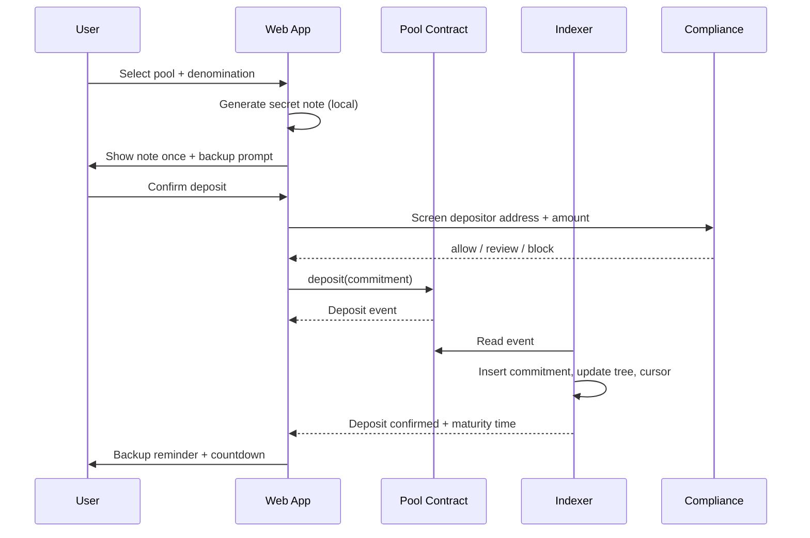
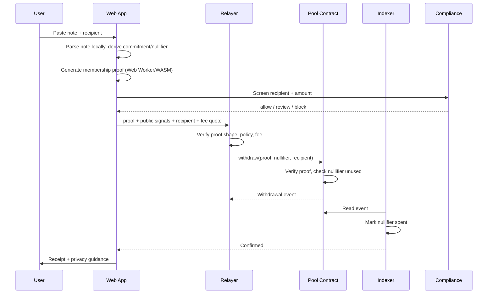

# VeilPool Product Specification

**Status:** Current · **Version:** 1.0 · **Date:** 2026-11-02
**Related:** [Pool Model](POOL_MODEL.md) · [Architecture](ARCHITECTURE.md) · [Prototype](../../prototype/index.html)

---

## 1. Product statement

> **VeilPool is a testnet-only private pool / mixer for fixed-denomination assets.**

It provides a clear, honest privacy flow:

```text
Select pool → deposit exact denomination → wait for anonymity set
→ generate proof locally → choose relayer → withdraw to a fresh address
```

The product does not custody notes, keys or funds. It does not claim untraceability. It shows
the anonymity set, maturity period, fees and compliance state so the user can make an
informed decision.

---

## 2. Target users

| User | Job to be done | Success looks like |
| --- | --- | --- |
| Privacy-conscious testnet user | Move test assets without exposing a direct link between deposit and withdrawal | Completes deposit → wait → withdrawal with a fresh address |
| Protocol researcher | Exercise a privacy pool end to end on testnets | Reproducible local/testnet run with observable events |
| Relayer operator | Earn fees for submitting valid withdrawals | Relayer submits proofs without learning notes |
| Compliance reviewer | Apply policy consistently | Clear reason, evidence and audit trail per decision |
| Operator | Keep pools healthy and safe | Pause, limits, reorg recovery and reconciliation work |

---

## 3. Product principles

1. **The note is the product’s critical asset.** Generate it locally, show it once, force a
   backup, and never send it to the backend.
2. **Fixed denominations.** Privacy comes from a shared set, not arbitrary amounts.
3. **Time matters.** Maturity and waiting guidance reduce timing correlation.
4. **Relayers are pipes, not custodians.** They receive a proof and recipient, not a note.
5. **Compliance is part of the flow.** Screening and limits are visible, not hidden.
6. **Show the privacy budget.** Anonymity-set size, pool liquidity and maturity are first-class.
7. **Fail closed.** Unknown network, stale root, expired policy, failed proof or blocked
   address stops the action.

---

## 4. Scope

### In scope

- Testnet assets: ETH, USDC, tBTC (test only).
- Fixed-denomination pools: ETH 0.1 / 1 / 10; USDC 100 / 1,000; tBTC 0.01.
- Deposit with client-generated secret note.
- Maturity countdown and anonymity-set display.
- Local proof generation and withdrawal.
- Non-custodial relayer selection, quotes and fallback.
- Address screening, jurisdiction checks and daily limits.
- Activity history is **local-only**: derived from the encrypted note vault and public pool
  events, without a server-side activity graph.
- Operator pause, limits and audit.
- Testnet-only chain gateway.

### Out of scope

- Mainnet, real funds, production custody.
- Arbitrary-amount mixing or splitting/merging.
- Cross-chain mixing.
- Fiat on/off-ramp.
- A claim of production-grade anonymity or audited cryptography.
- Native mobile apps (desktop-first; PWA may be considered later).
- Token issuance, yield, speculation.

---

## 5. Core user flows

### 5.1 Deposit



Key rules:

- The note is generated in the browser and never sent to the API.
- The deposit amount must equal the pool denomination exactly.
- A blocked address cannot deposit.
- A reverted transaction does not create a note that can be withdrawn.
- The UI must distinguish “submitted”, “confirmed”, “matured”.

### 5.2 Withdraw



Key rules:

- The note is parsed locally; no server endpoint accepts it.
- The proof must verify against the current Merkle root; stale roots fail closed.
- A nullifier can be spent once per pool.
- The recipient must pass screening; a blocked recipient stops submission.
- The relayer cannot see the note or control funds.
- The UI must handle relayer timeout, fallback and stuck transactions.

### 5.3 Recovery

- User imports an encrypted note backup.
- The app verifies note format, pool ID and network before use.
- If the note is already spent, show a clear “already withdrawn” state.
- If the note is for another pool, show the expected pool and refuse cross-pool use.
- If the note is corrupted, do not guess; show a checksum error.

---

## 6. Screens

| Screen | Primary job | Critical states |
| --- | --- | --- |
| Overview | See liquidity, anonymity set, compliance, quick actions | Healthy, degraded, paused |
| Deposit | Select pool, create/backup note, deposit | Note not backed up, blocked, tx pending/failed |
| Withdraw | Parse note, choose relayer, generate proof, withdraw | Invalid note, stale root, blocked recipient, relayer offline |
| Pools | Compare denominations, set size, fee, maturity | Active, low set, paused, low liquidity |
| Activity | See own deposits/withdrawals and backup status, locally | Pending, confirmed, matured, spent, failed |
| Relayers | Compare fee, latency, uptime | Online, degraded, offline, incompatible |
| Compliance | Understand screening, limits, jurisdiction, audit | Allow, review, block, list stale |
| Settings | Network, note backup, session, appearance | Testnet only, unbacked note, locked |

---

## 7. State machines

### 7.1 Deposit

```text
draft → note_created → compliance_check → submitted
      → confirmed → matured
      → failed (reverted / rejected)
      → cancelled (before submit)
```

- `confirmed` means the deposit event is indexed.
- `matured` means the maturity period has elapsed; withdrawal is allowed.
- A deposit can be `confirmed` but not yet `matured`.

### 7.2 Withdrawal

```text
draft → note_parsed → proof_ready → compliance_check
      → relayer_selected → submitted → confirmed
      → failed (proof / revert / relayer)
      → expired (quote or approval)
```

- `proof_ready` is local; no server record is required.
- `submitted` is not final; only `confirmed` means funds moved.
- A failed withdrawal does not consume the note unless the nullifier is on-chain.

### 7.3 Note

```text
unbacked → backed_up → unspent → pending → spent
                    ↘ corrupted / lost
```

- A note is `unbacked` until the user exports an encrypted backup.
- A note becomes `pending` after a withdrawal is submitted.
- A note is `spent` only when the nullifier is observed on-chain.
- A lost note is unrecoverable; the UI must say so plainly.

---

## 8. Privacy UX requirements

- Display **anonymity-set size** next to every denomination.
- Display **maturity** and a countdown.
- Warn when a pool has a small set (`< 100`) or low liquidity.
- Recommend waiting longer when deposit and withdrawal are close in time.
- Recommend a fresh recipient address unrelated to the deposit address.
- Never show a “100% anonymous” badge.
- Never auto-fill a recipient from the depositor wallet.
- Do not store notes in analytics, logs, error reports or support tickets.
- Redact note-like strings in logs and crash reports.

---

## 9. Compliance UX requirements

- Screening result must be visible before submission.
- A blocked action must show a stable reason code and a request ID.
- A manual-review state must explain what happens next and when it expires.
- The user must be able to export their own audit record.
- Policy version and sanctions-list version must be visible.
- Compliance must never ask for the note.

---

## 10. Success metrics

| Metric | Target |
| --- | --- |
| Deposit completion rate (valid users) | > 90% |
| Withdrawal completion rate after maturity | > 95% |
| Median deposit→maturity→withdraw time | Reported, not gamified |
| Proof generation success (supported browsers) | > 99% |
| Relayer submission success | > 98% |
| Reorg reconciliation without manual action | 100% for ≤ 12 blocks |
| Note backup completion before deposit | 100% (hard gate) |
| Compliance decision latency p95 | < 2 s |
| Mainnet access attempts | 0 |
| Notes stored server-side | 0 |
| Cross-user data exposure | 0 |

---

## 11. Open product questions

1. Should a note-health check query the nullifier without linking the note? If yes, how to
   avoid a privacy leak?
2. Should users be allowed to schedule withdrawals for a later time? Trade-off: convenience
   vs timing correlation.
3. Should relayer fees be fixed by the protocol or competitive? Competitive is better but
   adds UX complexity.
4. Should the product support multiple recipients per note? No in v1; it weakens fixed
   denomination guarantees.
5. How much compliance data can be retained without undermining privacy? See
   [COMPLIANCE.md](COMPLIANCE.md).
6. What is the minimum anonymity-set threshold before a pool is shown as “recommended”?
7. Do we need a native CLI for high-value testnet research runs? Optional.
