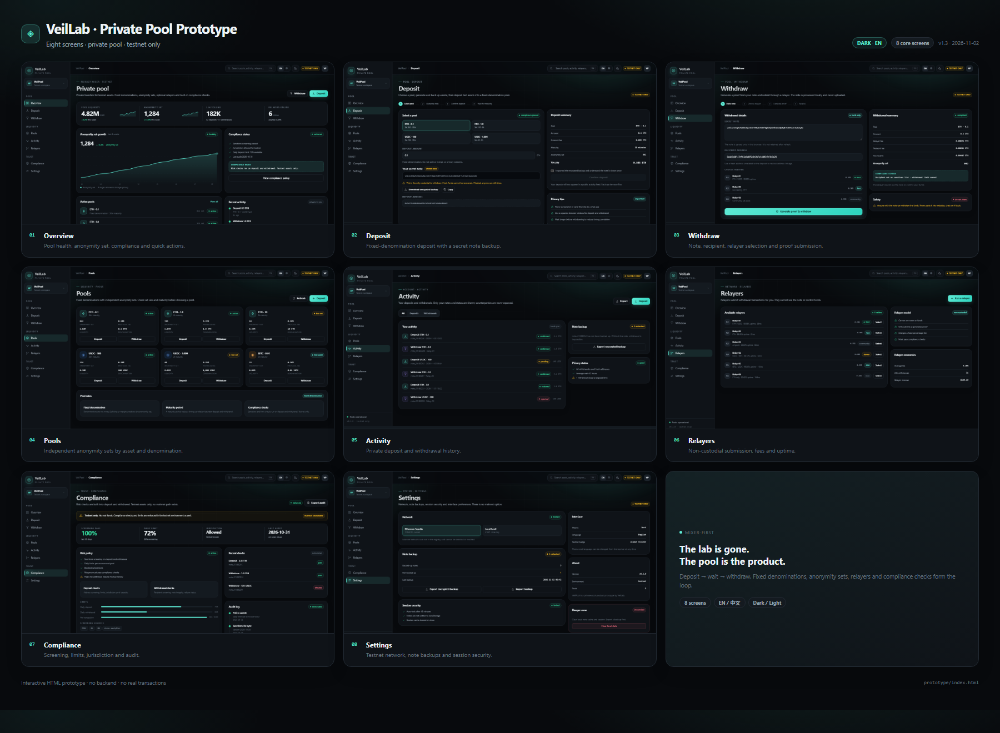
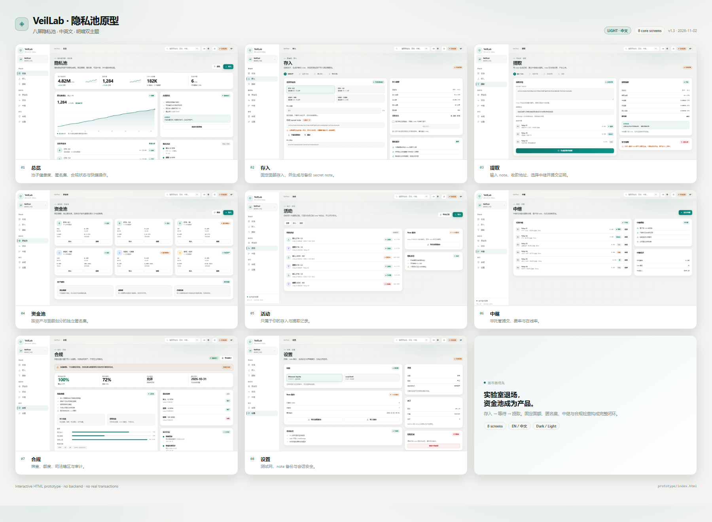
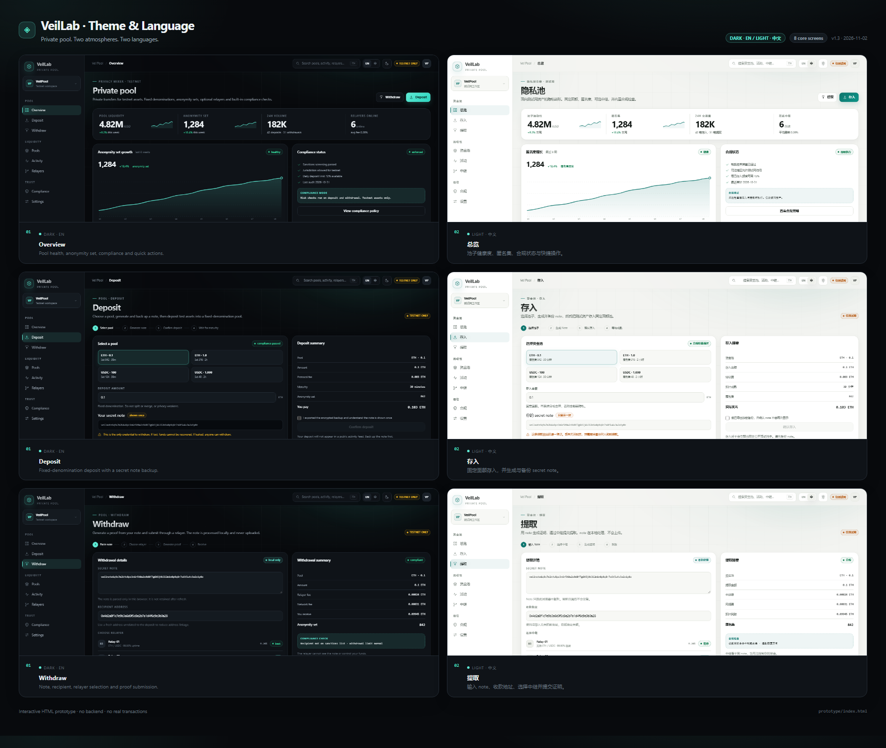

# VeilPool · Private Pool Prototype

**Status:** Draft · **Version:** 1.3 · **Date:** 2026-11-02
**Related:** [VeilPool product docs](../docs/veilpool/README.md) · [Product Spec](../docs/veilpool/PRODUCT_SPEC.md) · [Pool Model](../docs/veilpool/POOL_MODEL.md)

A mixer-first product prototype for **VeilPool**: fixed-denomination privacy pools for
testnet assets, with optional relayers and built-in compliance checks.

This is a static design artifact. Data is illustrative, buttons show a toast, and no
backend, wallet or chain is connected.

> **Testnet only.** No real funds, no mainnet path, no production signing.

---

## 1. What changed in v1.3

- Removed the research-lab surface: no Research, Protocols, Experiments, Crypto Lab,
  Security findings or AI Team navigation.
- Reduced to **8 product screens** focused on the mixer loop:
  deposit → wait for anonymity set → withdraw.
- Added **Pools, Activity, Relayers and Compliance** as first-class product areas.
- Refined the icon set with a custom VeilPool mark, duotone nav icons and asset marks
  (ETH / USDC / tBTC).
- Added motion details: pointer-following ambient light, card lift, animated nav marker,
  chart line drawing, button sheen, testnet pulse and note shimmer.
- Kept the v1.1 visual system, bilingual UI and dark/light themes.
- Added explicit security affordances: secret-note warnings, fresh-address guidance,
  relayer boundaries and compliance limits.

---

## 2. Open it

### Direct file

Open [`index.html`](index.html).

### Local server (recommended)

```bash
python -m http.server 8765
```

```text
http://127.0.0.1:8765/prototype/index.html?screen=overview
```

### URL parameters

| Parameter | Values | Default | Purpose |
| --- | --- | --- | --- |
| `screen` | `overview`, `deposit`, `withdraw`, `pools`, `activity`, `relayers`, `compliance`, `settings` | `overview` | Deep link |
| `theme` | `dark`, `light` | `dark` | Force theme |
| `lang` | `en`, `zh` | `en` | Force language |
| `static` | `1` | off | Disable transitions for screenshots |

Example:

```text
?screen=withdraw&theme=light&lang=zh&static=1
```

---

## 3. Maps

### Dark · English



### Light · 中文



### Theme and language comparison



---

## 4. Screens

| # | Screen | Dark / EN | Light / 中文 | Purpose |
| --- | --- | --- | --- | --- |
| 01 | Overview / 总览 | [`v3-dark-overview.png`](screenshots/v3-dark-overview.png) | [`v3-light-zh-overview.png`](screenshots/v3-light-zh-overview.png) | Liquidity, anonymity set, compliance, quick actions |
| 02 | Deposit / 存入 | [`v3-dark-deposit.png`](screenshots/v3-dark-deposit.png) | [`v3-light-zh-deposit.png`](screenshots/v3-light-zh-deposit.png) | Pool selection, secret note, deposit summary |
| 03 | Withdraw / 提取 | [`v3-dark-withdraw.png`](screenshots/v3-dark-withdraw.png) | [`v3-light-zh-withdraw.png`](screenshots/v3-light-zh-withdraw.png) | Note, recipient, relayer, proof submission |
| 04 | Pools / 资金池 | [`v3-dark-pools.png`](screenshots/v3-dark-pools.png) | [`v3-light-zh-pools.png`](screenshots/v3-light-zh-pools.png) | Assets, denominations, anonymity sets, fees |
| 05 | Activity / 活动 | [`v3-dark-activity.png`](screenshots/v3-dark-activity.png) | [`v3-light-zh-activity.png`](screenshots/v3-light-zh-activity.png) | Private deposit and withdrawal history |
| 06 | Relayers / 中继 | [`v3-dark-relayers.png`](screenshots/v3-dark-relayers.png) | [`v3-light-zh-relayers.png`](screenshots/v3-light-zh-relayers.png) | Non-custodial submission, fees, uptime |
| 07 | Compliance / 合规 | [`v3-dark-compliance.png`](screenshots/v3-dark-compliance.png) | [`v3-light-zh-compliance.png`](screenshots/v3-light-zh-compliance.png) | Screening, limits, jurisdiction, audit |
| 08 | Settings / 设置 | [`v3-dark-settings.png`](screenshots/v3-dark-settings.png) | [`v3-light-zh-settings.png`](screenshots/v3-light-zh-settings.png) | Testnet, note backup, session security |

---

## 5. Core product loop

```text
1. Choose a fixed-denomination pool
2. Generate and back up a secret note
3. Deposit test assets
4. Wait for maturity and anonymity-set growth
5. Generate a withdrawal proof locally
6. Select a relayer
7. Recipient receives funds on the testnet
```

The UI deliberately surfaces the constraints that make the privacy claim honest:

- fixed denominations, not arbitrary amounts;
- maturity periods, not instant exit;
- anonymity-set size, not a vague “private” badge;
- a secret note that the user must safeguard;
- a non-custodial relayer that cannot see the note;
- compliance checks on both deposit and withdrawal.

---

## 6. Design decisions

1. **Mixer-first, not research-first.** The first screen answers: how much liquidity, how
   large is the anonymity set, and how do I deposit or withdraw?
2. **Privacy is explained, not promised.** The UI shows set size, maturity and timing
   guidance instead of claiming “untraceable”.
3. **Notes are the product’s critical asset.** Deposit and withdrawal screens treat note
   generation, backup and leakage as first-class risks.
4. **Compliance is visible.** A dedicated screen shows screening, limits, jurisdiction and
   audit; testnet-only is persistent.
5. **Relayers are non-custodial.** The UI states they cannot see notes or control funds.
6. **Two atmospheres, one system.** Dark and light share tokens; EN/中文 never changes the
   information architecture.

### Visual and motion details

- **Backup gate** — the deposit confirmation is disabled until the user confirms an encrypted
  backup; this is a product boundary, not a decorative checkbox.
- **Accessibility** — Lighthouse accessibility 100 on overview/deposit in dark/light and
  EN/ZH; form labels, focus states, forced-colors fallback and reduced motion.
- **Custom icon language** — 24px grid, 1.5–1.7px strokes, rounded joins, duotone fills on
  nav, asset and compliance icons; custom VeilPool mark.
- **Ambient light** — a soft radial glow follows the pointer and drifts slowly on its own.
- **Page entrance** — cards rise in with a short stagger; chart lines draw once per screen.
- **Micro-interactions** — nav icons lift, card tops catch a fine accent line, primary
  buttons have a moving sheen, the testnet dot pulses, and the note box has a slow shimmer.
- **Contrast and calm** — motion is limited to 150–550ms, never loops on content, and is
  disabled by `prefers-reduced-motion` or `?static=1` for screenshots.

---

## 7. Not included

- Mainnet support, real funds or production signing.
- A live backend, wallet connection, indexer or proof circuit.
- A claim of production-grade anonymity.
- Mobile layouts; target is desktop ≥ 1180 px.
- Final legal/compliance copy.

---

## 8. Files

- `index.html` — interactive prototype
- `styles.css` — design tokens and components
- `app.js` — routing, i18n, theme persistence, tabs, toasts
- `contact-sheet.html?set=dark|light-zh|compare` — prototype maps
- `screenshots/` — 8 dark, 8 light-zh, maps and comparison

---

## 9. Next steps

1. Align the product docs with the mixer-first positioning (the current docs baseline still
   describes the earlier research platform).
2. Implement the app shell and deposit/withdraw flows in React.
3. Add loading, empty, error, rejected and blocked-jurisdiction states.
4. Add accessibility review and keyboard-first flows for note handling.
5. Replace static data with a testnet-only API and a real proof/relayer simulator.
